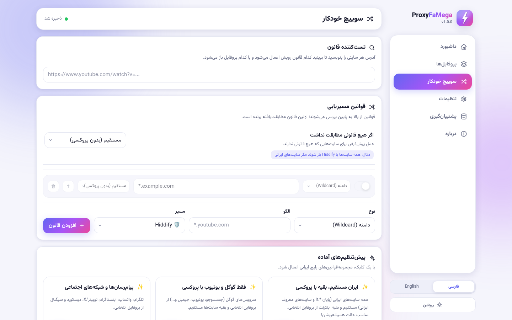

<div dir="rtl" align="center">


# ⚡ پروکسی‌فا مگا (ProxyFaMega)

**مدیریت پروکسی مرورگر — فارسی، زیبا و حرفه‌ای**

افزونه‌ای مدرن با طراحی الهام‌گرفته از iOS برای مدیریت پروفایل‌های پروکسی؛ بازطراحی و بومی‌سازی افزونهٔ [ZeroOmega](https://github.com/zero-peak/ZeroOmega) — شامل ۱۰ پروفایل آماده (Hiddify، v2rayN، NekoBox، Happ، Clash و...)، سوییچ خودکار هوشمند با حالت پیش‌فرض **«سایت‌های ایرانی مستقیم، بقیه با پروکسی»** و ۸ تم رنگی جذاب.

توسعه‌یافته با ❤️ و ☕ توسط **[100ri.ir](https://github.com/100ri-ir)** برای کاربران فارسی‌زبان

</div>

<div dir="rtl" align="center">

     

[](https://github.com/100ri-ir/ProxyFaMega/releases/latest) [](https://github.com/100ri-ir/ProxyFaMega/stargazers) [](https://github.com/100ri-ir/ProxyFaMega/actions/workflows/release.yml)

**[📥 دانلود آخرین نسخه](https://github.com/100ri-ir/ProxyFaMega/releases/latest)** · **[✨ امکانات](#-امکانات)** · **[📥 آموزش نصب](#-آموزش-نصب)** · **[🎬 پیش‌نمایش بدون نصب](#-مشاهده-پیشنمایش-بدون-نیاز-به-نصب)** · **[🇬🇧 English](#-proxyfamega-english)**

</div>

<div dir="rtl">

---

## 💡 چرا ProxyFaMega؟

اکثر کاربرانی که با برنامه‌هایی مانند Hiddify، v2rayN یا NekoBox کار می‌کنند، معمولاً با مشکل تغییر سریع و آسان پروکسی در مرورگر مواجه می‌شوند. افزونه‌های قدیمی‌تر مثل SwitchyOmega یا نسخهٔ جدیدتر آن (ZeroOmega)، با وجود عملکرد عالی، از زبان فارسی پشتیبانی نمی‌کنند، رابط کاربری نسبتاً قدیمی دارند و هیچ‌گونه تنظیمات پیش‌فرضی برای کاربران ایرانی ارائه نمی‌دهند.

افزونهٔ **ProxyFaMega** همان کارایی قدرتمند را با یک رابط کاربری کاملاً فارسی، راست‌چین و مدرن در اختیار شما قرار می‌دهد. پشتیبانی از پورت‌های پیش‌فرض برنامه‌های رایج، تنظیمات آماده برای سایت‌های ایرانی، و ارائهٔ توضیحات و مثال‌های واضح برای هر بخش، باعث شده تا حتی کاربران مبتدی نیز بتوانند به‌راحتی و بدون سردرگمی از آن استفاده کنند.

## ✨ امکانات

- 🇮🇷 **پشتیبانی کامل از زبان فارسی (راست‌چین)** و انگلیسی — با فونت زیبای **[وزیرمتن](https://github.com/rastikerdar/vazirmatn)** و قابلیت تغییر زبان در لحظه.
- 🎨 **۸ تم رنگی مدرن و جذاب** (شفق قطبی، غروب، اقیانوس، نعنایی، آب‌نباتی، طلایی، نیمه‌شب، نئون) + **حالت شب (Dark Mode) خودکار** هماهنگ با سیستم‌عامل.
- 🚀 **۱۰ پروفایل آماده** با پورت‌های پیش‌فرض برای برنامه‌های رایج (جدول کامل در ادامه ⬇️).
- 🔀 **سوییچ خودکار هوشمند** با پشتیبانی از قوانین دامنه/آدرس/Regex + **ابزار تست زندهٔ آدرس** + ۴ پیش‌تنظیم آماده، از جمله حالت **«ایران مستقیم، بقیه با پروکسی»** (ترافیک دامنه‌های `ir.` و سایت‌های پرکاربرد ایرانی مانند دیجی‌کالا، آپارات، ترب، ورزش۳ و... به‌صورت مستقیم و بدون پروکسی هدایت می‌شود).
- 💾 **سیستم پشتیبان‌گیری (Backup) حرفه‌ای**: خروجی رمزنگاری‌شده با استاندارد AES-256-GCM، ذخیرهٔ خودکار تاریخچه (تا ۱۰ نسخه) و **امکان درون‌ریزی (Import) مستقیم از ZeroOmega / SwitchyOmega**.
- 📝 **توضیحات و مثال‌های کاربردی فارسی** برای تمامی تنظیمات.
- ⌨️ میان‌بر `Alt+Shift+P` برای جابه‌جایی سریع بین پروفایل‌ها، منوی راست‌کلیک روی آیکون، نشانگر رنگی وضعیت، و ابزار تست سرعت اتصال.
- 🔒 **ذخیرهٔ خودکار** تمامی تغییرات + قابلیت همگام‌سازی اختیاری بین دستگاه‌های مختلف.
- 🕵️ **حریم خصوصی کامل** — هیچ‌گونه اطلاعاتی جمع‌آوری نمی‌شود و همه‌چیز فقط روی دستگاه خودتان باقی می‌ماند.
- 🧪 **پایداری بالا** — پشت‌سرگذاشتن تمامی تست‌های منطقی و PAC پیش از انتشار هر نسخه.

## 🚀 ۱۰ پروفایل آماده

| برنامه | پورت | پروتکل |
|---|---:|---|
| Hiddify | `12334` | Mixed (SOCKS5/HTTP) |
| v2rayN / V2Ray | `10808` | SOCKS5 |
| v2rayN (HTTP) | `10809` | HTTP |
| NekoBox / Nekoray | `2080` | Mixed (SOCKS5/HTTP) |
| Happ | `10808` | SOCKS5 (HTTP: `10809`) |
| Clash Verge / CFW | `7890` | Mixed (HTTP/SOCKS5) |
| Firefox Proxy | `10810` | سفارشی |
| Shadowsocks | `1080` | SOCKS5 |
| Tor | `9050` | SOCKS5 |
| Psiphon | `8080` | HTTP (SOCKS: `1080`) |

## 📸 نگاهی به رابط کاربری

<table>
<tr>
<td width="50%"></td>
<td width="50%"></td>
</tr>
<tr>
<td width="50%"></td>
<td width="50%"></td>
</tr>
<tr>
<td width="30%"></td>
<td width="30%"></td>
<td width="30%"></td>
</tr>
</table>

<details>
<summary><b>📸 تصاویر بیشتر</b> (تنظیمات، ویرایشگر پروفایل، نسخهٔ انگلیسی و...)</summary>

<table>
<tr><td width="50%"></td><td width="50%"></td></tr>
<tr><td width="50%"></td><td width="50%"></td></tr>
</table>

</details>

## 📥 آموزش نصب

### 🟢 مرورگرهای مبتنی بر کرومیوم (Chrome, Edge, Brave)

۱. آخرین نسخه را از [**صفحهٔ Releases**](https://github.com/100ri-ir/ProxyFaMega/releases/latest) دانلود کنید: فایل `ProxyFaMega-v1.0.0-chrome.zip` (این فایل برای مرورگر اج نیز مناسب است).
۲. فایل ZIP دانلودشده را استخراج (Extract) کنید.
۳. در نوار آدرس مرورگر خود عبارت `chrome://extensions` (و در اج `edge://extensions`) را وارد کنید.
۴. گزینهٔ **Developer mode** (حالت توسعه‌دهنده) را در گوشهٔ صفحه فعال کنید.
۵. روی دکمهٔ **Load unpacked** کلیک کرده و پوشهٔ استخراج‌شده را انتخاب کنید.

### 🦊 مرورگر فایرفاکس

۱. در نوار آدرس مرورگر عبارت `about:debugging#/runtime/this-firefox` را وارد کنید.
۲. روی **Load Temporary Add-on…** کلیک کنید و فایل `manifest.json` واقع در پوشهٔ `firefox` را انتخاب نمایید.

> 💡 **توجه:** نصب از این طریق در فایرفاکس موقتی بوده و با بستن مرورگر حذف می‌شود. نسخهٔ نهایی افزونه به‌زودی در فروشگاه رسمی افزونه‌های فایرفاکس منتشر خواهد شد.

## ⌨️ کلیدهای میان‌بر

| عملکرد | کلید میان‌بر |
|---|---|
| رفتن به پروفایل بعدی | `Alt + Shift + P` |
| بازگشت به پروفایل قبلی | `Alt + Shift + O` |

## 🎬 مشاهده پیش‌نمایش (بدون نیاز به نصب)

شما می‌توانید فایل‌های `options/options.html` و `popup/popup.html` را مستقیماً در مرورگر خود باز کنید. در این حالت افزونه در **حالت دمو** و با داده‌های نمونه اجرا می‌شود:

```text
options/options.html?view=auto&mode=dark&lang=en
```

**پارامترهای قابل تغییر:** 
- `view` (`dashboard` / `profiles` / `auto` / `settings` / `backup` / `about`)
- `mode` (`light` / `dark`)
- `lang` (`fa` / `en`)
- `theme` (مانند `aurora`، `sunset`، `ocean`، `midnight` و...)

## 🛠️ بیلد و توسعه از سورس کد

```bash
git clone https://github.com/100ri-ir/ProxyFaMega.git
cd ProxyFaMega
python3 scripts/build.py      # → ایجاد خروجی در مسیر: dist/ProxyFaMega-v1.0.0-{chrome,firefox,edge}.zip
node test/logic_test.js       # اجرای تست‌های منطق و PAC
python3 scripts/check_i18n.py # بررسی سلامت و یکپارچگی ترجمه‌ها
```

**پیش‌نیازها:** تنها به **پایتون ۳.۶+** و **Node.js** نیاز دارید و هیچ وابستگی خارجی دیگری وجود ندارد. بسته‌های توزیع نیز به‌صورت خودکار توسط GitHub Actions در بخش [Releases](https://github.com/100ri-ir/ProxyFaMega/releases) قرار می‌گیرند.

## 🔄 انتقال اطلاعات از ZeroOmega یا SwitchyOmega

کافیست به بخش **پشتیبان‌گیری ← بازیابی** بروید و فایل خروجی (JSON) گرفته‌شده از ZeroOmega یا SwitchyOmega را در آنجا رها کنید (Drag & Drop). پروفایل‌ها و قوانین سوییچ خودکار شما به همراه پیش‌نمایش، آمادهٔ انتقال (با قابلیت ادغام یا جایگزینی) خواهند بود.

## 🧩 ساختار پروژه

```text
ProxyFaMega/
├── src/                  ← سورس اصلی افزونه
│   ├── background/       ← سرویس‌ورکر MV3 (کرومیوم) و موتور پروکسی MV2 (فایرفاکس)
│   ├── common/           ← ثابت‌ها، تم‌ها، i18n، ذخیره‌سازی، موتور قوانین (matcher/PAC)
│   ├── popup/            ← پاپ‌آپ تعویض سریع
│   ├── options/          ← تنظیمات کامل (داشبورد، پروفایل‌ها، سوییچ خودکار، بکاپ...)
│   ├── assets/           ← آیکون‌ها + فونت وزیرمتن (۴ وزن)
│   ├── _locales/         ← فایل‌های بومی‌سازی زبان‌ها (fa / en)
│   └── manifests/        ← مانیفست‌های مرورگرها (chrome / firefox)
├── scripts/              ← اسکریپت‌های کاربردی: build.py ، gen_icons.py ، check_i18n.py
├── test/                 ← تست‌های منطق و PAC (اجرا با Node.js)
├── screenshots/          ← تصاویر پیش‌نمایش رابط کاربری
├── assets/               ← بنرها و فایل‌های گرافیکی داکیومنت
└── .github/workflows/    ← تنظیمات بیلد و انتشار خودکار در گیت‌هاب
```

## 🗺️ نقشهٔ راه (Roadmap)

- [x] انتشار نسخهٔ ۱.۰ — داشبورد، پروفایل‌ها، سوییچ خودکار، بکاپ، ۸ تم جذاب، دوزبانه
- [ ] انتشار رسمی در فروشگاه افزونه‌های Chrome Web Store و Firefox Add-ons
- [ ] اضافه‌کردن پروفایل‌های آمادهٔ بیشتر + قابلیت ویرایش گروهی
- [ ] امکان خروجی‌گرفتن و درون‌ریزی قوانین با فرمت‌های رایج (نظیر Clash و PAC)
- [ ] اضافه‌شدن ابزار تست‌کنندهٔ پروکسی درون خود افزونه

## 🤝 سپاس‌گزاری

این پروژه یک **بازطراحی و بومی‌سازی** از ایدهٔ محبوب مدیریت پروکسی مرورگر است که توسعهٔ آن بدون پروژه‌های متن‌باز زیر امکان‌پذیر نبود:

- [**ZeroOmega**](https://github.com/zero-peak/ZeroOmega) — الهام‌بخش اصلی این پروژه و جانشین مدرن SwitchyOmega.
- [**SwitchyOmega**](https://github.com/FelisCatus/SwitchyOmega) — افزونهٔ کلاسیک و قدرتمند مدیریت پروکسی که سال‌ها مورد استفادهٔ کاربران بود.
- [**وزیرمتن (Vazirmatn)**](https://github.com/rastikerdar/vazirmatn) — فونت بی‌نظیر و زیبای فارسی، اثر زنده‌یاد [صابر راستی‌کردار](https://github.com/rastikerdar).

## 👤 سازنده

<div align="right">

این پروژه توسط **[100ri.ir](https://github.com/100ri-ir)** با عشق ❤️ توسعه و منتشر شده است.

اگر ProxyFaMega برای شما مفید بود، لطفاً با دادن ستاره (⭐) در گیت‌هاب از ما حمایت کنید. دمتان گرم و اینترنتتان آزاد!

</div>

## 📄 مجوز و سلب مسئولیت

**[MIT](LICENSE)** — این پروژه کاملاً متن‌باز و آزاد برای استفاده، تغییر و انتشار مجدد است.

> ⚠️ **سلب مسئولیت:** این افزونه تنها یک ابزار برای «مدیریت پروکسی» است و هیچ‌گونه سرور یا کانفیگی به همراه ندارد. استفاده از آن برای مصارف شخصی و قانونی است و مسئولیت نحوهٔ استفاده کاملاً بر عهدهٔ کاربر است. این افزونه هیچ داده‌ای را جمع‌آوری نکرده و اطلاعاتی به هیچ سروری ارسال نمی‌کند.

</div>

<div dir="ltr" align="center">

---

# ⚡ ProxyFaMega (English)


**A gorgeous, Persian-first browser proxy manager** — an Iranian-made, Persian-redesigned take on the classic [ZeroOmega](https://github.com/zero-peak/ZeroOmega) / SwitchyOmega idea, built with ❤️ by **[100ri.ir](https://github.com/100ri-ir)**.

[](https://github.com/100ri-ir/ProxyFaMega/releases/latest)
[](LICENSE)
[](https://github.com/100ri-ir/ProxyFaMega#-install)

[**📥 Download**](https://github.com/100ri-ir/ProxyFaMega/releases/latest) · [**✨ Features**](#-features) · [**📥 Install**](#-install) · [**🎬 Live preview**](#-live-preview-without-installing)

</div>

<div dir="ltr">

## Why ProxyFaMega?

If you run Hiddify, v2rayN or NekoBox, you know the pain: switching the browser proxy mid-work. SwitchyOmega (and its successor ZeroOmega) are legendary — but English-only, dated-looking, and with zero defaults for the apps most Iranian users actually use. ProxyFaMega brings the same power with a fully Persian (RTL), iOS-inspired UI, ready-made profiles for the apps people use today, Iranian one-click presets, and a friendly explanation under every single setting.

## ✨ Features

- 🇮🇷 **Persian-first, fully RTL** + English — instant language switching, beautiful [Vazirmatn](https://github.com/rastikerdar/vazirmatn) font baked in.
- 🎨 **8 iOS-style color themes** (Aurora, Sunset, Ocean, Mint, Candy, Gold, Midnight, Neon) + **auto dark mode** following the OS.
- 🚀 **10 ready-made profiles** — Hiddify `12334`, v2rayN `10808/10809`, NekoBox `2080`, Happ, Clash `7890`, Shadowsocks `1080`, Tor `9050`, Psiphon `8080`, and more.
- 🔀 **Smart auto-switch** with domain/URL/regex rules, a **live URL tester**, and 4 one-click presets — including **"Iran direct, rest proxied"** (every `*.ir` site plus famous Iranian sites stays direct).
- 💾 **Professional backup** — AES-256-GCM encrypted exports, automatic snapshots (up to 10), and **direct import from ZeroOmega / SwitchyOmega**.
- 📝 **Every setting documented** with a Persian explanation and a practical example.
- ⌨️ `Alt+Shift+P` / `Alt+Shift+O` shortcuts, context menu, colored status badge, connection latency test.
- 🔒 **Autosave everywhere** + optional cross-device sync.
- 🕵️ **Zero telemetry** — everything stays on your device.
- 🧪 **Logic & PAC test suite** — releases are built only with green tests.

## 📥 Install

**Chrome / Brave / Edge (MV3) & Firefox (MV2):** grab the latest zip from the [Releases page](https://github.com/100ri-ir/ProxyFaMega/releases/latest), extract it, then:

- **Chrome / Brave / Edge:** open `chrome://extensions` (or `edge://extensions`), enable **Developer mode**, click **Load unpacked** and select the extracted folder.
- **Firefox:** open `about:debugging#/runtime/this-firefox`, click **Load Temporary Add-on…** and pick the `manifest.json` inside the firefox package.

## 🎬 Live preview without installing

Open `options/options.html` or `popup/popup.html` directly in any browser — the extension runs in **demo mode** with sample data:

```text
options/options.html?view=auto&mode=dark&lang=en
```

Parameters: `view` (`dashboard`, `profiles`, `auto`, `settings`, `backup`, `about`), `mode` (`light`/`dark`), `lang` (`fa`/`en`), `theme` (e.g. `aurora`, `sunset`, `ocean`, `midnight`…).

## 🛠️ Build from source

```bash
git clone https://github.com/100ri-ir/ProxyFaMega.git
cd ProxyFaMega
python3 scripts/build.py      # -> dist/ProxyFaMega-v1.0.0-{chrome,firefox,edge}.zip
node test/logic_test.js       # logic & PAC tests
python3 scripts/check_i18n.py # translation health check
```

Requirements: **Python 3.6+** and **Node** only — no external dependencies. Tagged commits automatically build and publish packages via GitHub Actions.

## 🔄 Migrating from ZeroOmega / SwitchyOmega

Backup page → Restore → drop the JSON export from ZeroOmega or SwitchyOmega; profiles and auto-switch rules are imported with a preview and merge/replace options.

## 🤝 Credits

- [**ZeroOmega**](https://github.com/zero-peak/ZeroOmega) — the main inspiration for this project.
- [**SwitchyOmega**](https://github.com/FelisCatus/SwitchyOmega) — the classic proxy manager.
- [**Vazirmatn**](https://github.com/rastikerdar/vazirmatn) — the beautiful Persian font.

## 📄 License

**[MIT](LICENSE)** — free to use, modify and share. This extension is a proxy *manager*: it ships no servers or configs and collects no data; use it responsibly.

**Made with ❤️ in Iran by [100ri.ir](https://github.com/100ri-ir)** — if it helps you, give it a star ⭐

</div>