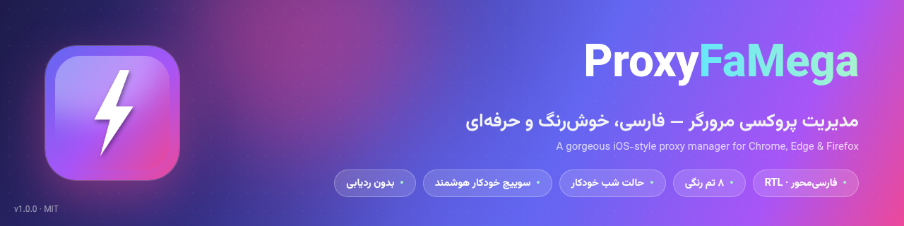
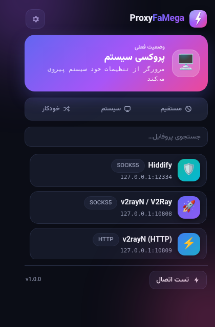
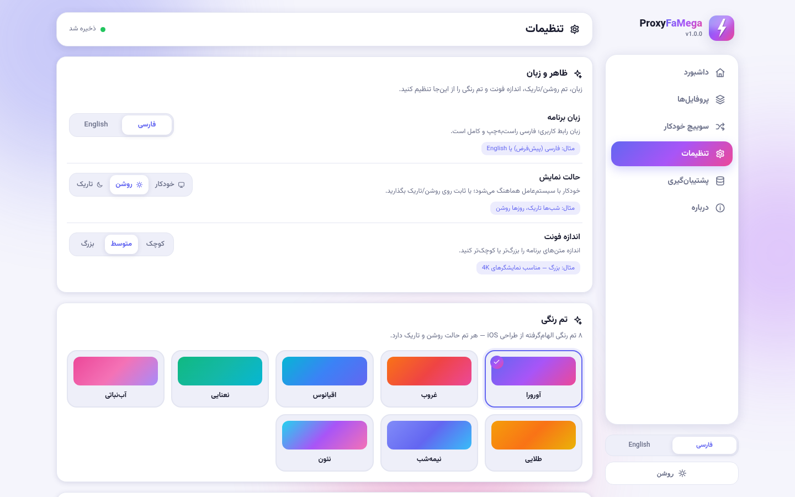
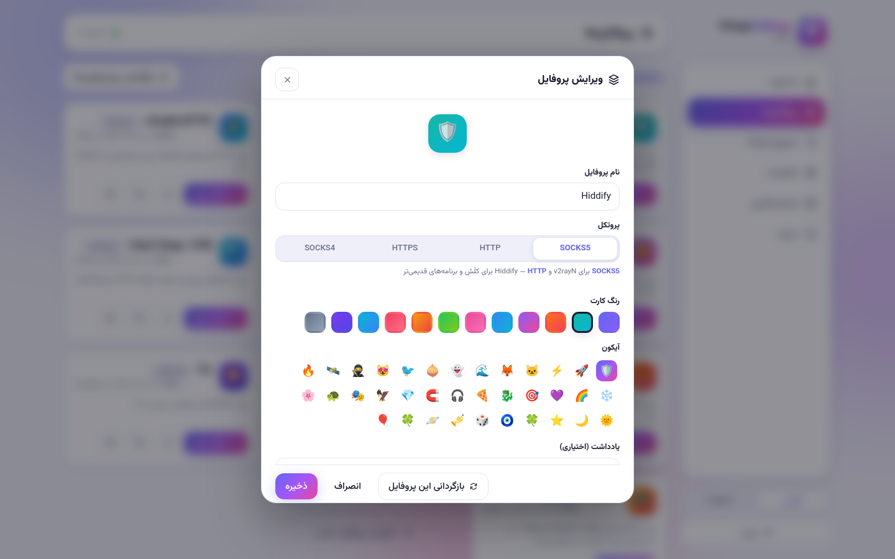

&#x20;\<div dir="rtl" align="center">

\

# ⚡ پروکسی‌فا مگا | ProxyFaMega

### مدیریت هوشمند پروکسی مرورگر، با تجربه‌ای فارسی و مدرن

افزونه‌ای قدرتمند برای مدیریت پروفایل‌های پروکسی مرورگر، با رابط کاربری فارسی و راست‌چین، طراحی الهام‌گرفته از iOS و پشتیبانی از پروفایل‌های آماده برنامه‌های محبوبی مانند Hiddify، v2rayN، NekoBox، Happ و Clash.

بازطراحی و فارسی‌سازی ایده مدیریت پروکسی [ZeroOmega](https://github.com/zero-peak/ZeroOmega) با امکانات اختصاصی، سوییچ خودکار هوشمند و تنظیمات آماده برای کاربران ایرانی.

**ساخته‌شده با ❤️ و ☕ توسط [100ri.ir](https://github.com/100ri-ir)**

\</div>

\<div align="center">


\


\


[📥 دانلود آخرین نسخه](https://github.com/100ri-ir/ProxyFaMega/releases/latest) · [✨ امکانات](#-امکانات) · [📸 تصاویر](#-نمایی-از-محیط-افزونه) · [📥 راهنمای نصب](#-راهنمای-نصب) · [🇬🇧 English](#proxyfamega-english)

\</div>

---

\<div dir="rtl">

## 📑 فهرست مطالب

- [معرفی پروژه](#-معرفی-پروژه)
- [امکانات](#-امکانات)
- [پروفایل‌های آماده](#-پروفایلهای-آماده)
- [نمایی از محیط افزونه](#-نمایی-از-محیط-افزونه)
- [راهنمای نصب](#-راهنمای-نصب)
- [میان‌برهای صفحه‌کلید](#-میانبرهای-صفحهکلید)
- [پیش‌نمایش بدون نصب](#-پیشنمایش-بدون-نصب)
- [ساخت از سورس](#-ساخت-از-سورس)
- [مهاجرت از ZeroOmega](#-مهاجرت-از-zeroomega--switchyomega)
- [ساختار پروژه](#-ساختار-پروژه)
- [نقشه راه](#-نقشه-راه)
- [سپاس‌گزاری](#-سپاسگزاری)
- [مجوز و سلب مسئولیت](#-مجوز-و-سلب-مسئولیت)

## 💡 معرفی پروژه

اگر از برنامه‌هایی مانند Hiddify، v2rayN، NekoBox یا Clash استفاده می‌کنید، احتمالاً بارها به تغییر تنظیمات پروکسی مرورگر نیاز پیدا کرده‌اید.

افزونه ProxyFaMega با هدف ساده‌تر کردن همین فرایند طراحی شده است.

این پروژه با الهام از [ZeroOmega](https://github.com/zero-peak/ZeroOmega) و [SwitchyOmega](https://github.com/FelisCatus/SwitchyOmega)، تجربه‌ای جدید از مدیریت پروکسی مرورگر ارائه می‌دهد:

- رابط کاربری کاملاً فارسی و راست‌چین
- پروفایل‌های آماده برای برنامه‌های پراستفاده
- مدیریت دستی و خودکار پروکسی
- قوانین هوشمند بر اساس دامنه، آدرس و Regex
- پشتیبان‌گیری و بازیابی تنظیمات
- طراحی مدرن، سبک و قابل شخصی‌سازی

هدف این است که مدیریت پروکسی مرورگر، بدون پیچیدگی‌های فنی و با چند کلیک ساده انجام شود.

## ✨ امکانات

### 🌐 رابط کاربری و شخصی‌سازی

- 🇮🇷 پشتیبانی کامل از زبان فارسی و چیدمان RTL
- 🇬🇧 پشتیبانی از زبان انگلیسی و تغییر زبان در لحظه
- فونت فارسی [Vazirmatn](https://github.com/rastikerdar/vazirmatn)
- طراحی مدرن با الهام از رابط کاربری iOS
- 🎨 هشت تم رنگی:
  - Aurora
  - Sunset
  - Ocean
  - Mint
  - Candy
  - Gold
  - Midnight
  - Neon
- پشتیبانی از حالت روشن، تاریک و تشخیص خودکار حالت سیستم

### 🚀 مدیریت پروفایل‌های پروکسی

- ده پروفایل آماده برای برنامه‌های محبوب
- تعریف پروفایل‌های اختصاصی
- پشتیبانی از تنظیمات HTTP، SOCKS5 و Mixed
- ذخیره خودکار تغییرات
- جابه‌جایی سریع بین پروفایل‌ها
- نمایش وضعیت پروفایل فعال

### 🔀 سوییچ خودکار هوشمند

- تعریف قوانین بر اساس دامنه و آدرس اینترنتی
- پشتیبانی از Regex
- تست زنده قوانین با وارد کردن آدرس
- چهار الگوی آماده برای مدیریت ترافیک
- پیش‌تنظیم ویژه **«ایران مستقیم، سایر سایت‌ها با پروکسی»**

در این حالت، دامنه‌های `.ir` و فهرستی از وب‌سایت‌های ایرانی شناخته‌شده، از جمله دیجی‌کالا، آپارات، ترب و موارد دیگر، مستقیماً متصل می‌شوند.

### 💾 پشتیبان‌گیری و بازیابی

- خروجی گرفتن از تنظیمات
- رمزنگاری فایل پشتیبان با AES-256-GCM
- ایجاد خودکار Snapshot
- نگهداری حداکثر ۱۰ نسخه پشتیبان
- درون‌ریزی مستقیم تنظیمات ZeroOmega و SwitchyOmega
- امکان مشاهده پیش‌نمایش و انتخاب ادغام یا جایگزینی اطلاعات

### ⌨️ امکانات تکمیلی

- میان‌برهای صفحه‌کلید
- منوی اختصاصی راست‌کلیک روی آیکون افزونه
- نشانگر رنگی وضعیت پروکسی
- تست تأخیر اتصال
- همگام‌سازی اختیاری بین دستگاه‌ها
- توضیحات فارسی و مثال کاربردی برای تنظیمات

### 🔒 حریم خصوصی

- بدون سیستم Telemetry
- بدون جمع‌آوری اطلاعات کاربران
- ذخیره‌سازی اطلاعات به‌صورت محلی
- بدون نیاز به حساب کاربری اختصاصی

### 🧪 کنترل کیفیت

- تست‌های منطقی
- تست موتور تولید PAC
- بررسی سلامت ترجمه‌ها
- اجرای تست‌ها در فرایند انتشار خودکار

---

## 🚀 پروفایل‌های آماده

ProxyFaMega با ۱۰ پروفایل از پیش تعریف‌شده عرضه می‌شود:

| برنامه            | پورت پیش‌فرض | پروتکل                 |
| :---------------- | :----------: | :--------------------- |
| Hiddify           |    `12334`   | Mixed (SOCKS5 / HTTP)  |
| v2rayN / V2Ray    |    `10808`   | SOCKS5                 |
| v2rayN (HTTP)     |    `10809`   | HTTP                   |
| NekoBox / Nekoray |    `2080`    | Mixed (SOCKS5 / HTTP)  |
| Happ              |    `10808`   | SOCKS5 (HTTP: `10809`) |
| Clash Verge / CFW |    `7890`    | Mixed (HTTP / SOCKS5)  |
| Firefox Proxy     |    `10810`   | سفارشی                 |
| Shadowsocks       |    `1080`    | SOCKS5                 |
| Tor               |    `9050`    | SOCKS5                 |
| Psiphon           |    `8080`    | HTTP (SOCKS: `1080`)   |

> **نکته:** پورت‌های فوق مقادیر پیش‌فرض هستند و ممکن است با توجه به تنظیمات برنامه یا نسخه آن متفاوت باشند. در صورت نیاز می‌توانید اطلاعات اتصال را در پروفایل مربوطه تغییر دهید.

---

## 📸 نمایی از محیط افزونه

\<div align="center">

### داشبورد اصلی

\<table>
\<tr>
\<td width="50%" align="center">
\*\*حالت روشن\*\*

\
\</td>
\<td width="50%" align="center">
\*\*حالت تاریک\*\*

\
\</td>
\</tr>
\</table>

### مدیریت پروفایل‌ها و سوییچ خودکار

\<table>
\<tr>
\<td width="50%" align="center">
\*\*مدیریت پروفایل‌ها\*\*

\
\</td>
\<td width="50%" align="center">
\*\*سوییچ خودکار\*\*

\
\</td>
\</tr>
\</table>

### پنجره سریع و پشتیبان‌گیری

\<table>
\<tr>
\<td width="33%" align="center">
\*\*Popup روشن\*\*

\
\</td>
\<td width="33%" align="center">
\*\*Popup تاریک\*\*

\
\</td>
\<td width="33%" align="center">
\*\*پشتیبان‌گیری\*\*

\
\</td>
\</tr>
\</table>

\</div>

\<details>
\<summary>\<b>📷 مشاهده تصاویر بیشتر\</b>\</summary>

\<table>
\<tr>
\<td width="50%" align="center">

**تنظیمات**

\

\</td>
\<td width="50%" align="center">

**نسخه انگلیسی**

\

\</td>
\</tr>
\<tr>
\<td width="50%" align="center">

**ویرایشگر پروفایل**

\

\</td>
\<td width="50%" align="center">

**تغییر پروفایل**

\

\</td>
\</tr>
\</table>

\</details>

---

## 📥 راهنمای نصب

### 🟢 Google Chrome، Brave و Microsoft Edge

۱. وارد [صفحه آخرین نسخه‌ها (Releases)](https://github.com/100ri-ir/ProxyFaMega/releases/latest) شوید.

۲. بسته ZIP مربوط به مرورگر خود را دریافت کنید.

۳. فایل دانلودشده را Extract کنید.

۴. صفحه مدیریت افزونه‌ها را باز کنید:

| مرورگر | آدرس                  |
| :----- | :-------------------- |
| Chrome | `chrome://extensions` |
| Brave  | `brave://extensions`  |
| Edge   | `edge://extensions`   |

۵. گزینه **Developer mode** را فعال کنید.

۶. روی **Load unpacked** کلیک کنید.

۷. پوشه استخراج‌شده افزونه را انتخاب کنید.

### 🦊 Mozilla Firefox

۱. بسته مخصوص Firefox را از صفحه Releases دریافت کنید.

۲. فایل ZIP را استخراج کنید.

۳. وارد آدرس زیر شوید:

`about:debugging#/runtime/this-firefox`

۴. روی **Load Temporary Add-on…** کلیک کنید.

۵. فایل `manifest.json` موجود در بسته Firefox را انتخاب کنید.

> **توجه:** بارگذاری افزونه به این روش در فایرفاکس موقت است و با بسته‌شدن مرورگر، افزونه از فهرست افزونه‌های موقت حذف می‌شود. انتشار از طریق فروشگاه افزونه‌ها در نقشه راه پروژه قرار دارد.

---

## ⌨️ میان‌برهای صفحه‌کلید

| عملکرد               |      میان‌بر      |
| :------------------- | :---------------: |
| رفتن به پروفایل بعدی | `Alt + Shift + P` |
| رفتن به پروفایل قبلی | `Alt + Shift + O` |

---

## 🎬 پیش‌نمایش بدون نصب

برای مشاهده محیط افزونه بدون نصب آن، می‌توانید فایل‌های زیر را مستقیماً در مرورگر باز کنید:

- `options/options.html`
- `popup/popup.html`

در این حالت، افزونه با اطلاعات نمونه و در **Demo Mode** اجرا می‌شود.

برای نمونه، آدرس زیر را در مرورگر باز کنید:

```text
options/options.html?view=auto&mode=dark&lang=en
```

### پارامترهای قابل استفاده

| پارامتر | مقادیر                                                                   |
| :------ | :----------------------------------------------------------------------- |
| `view`  | `dashboard`، `profiles`، `auto`، `settings`، `backup`، `about`           |
| `mode`  | `light`، `dark`                                                          |
| `lang`  | `fa`، `en`                                                               |
| `theme` | `aurora`، `sunset`، `ocean`، `mint`، `candy`، `gold`، `midnight`، `neon` |

---

## 🛠️ ساخت پروژه از سورس

### پیش‌نیازها

- Python 3.6 یا بالاتر
- Node.js

این پروژه برای ساخت بسته‌های توزیع به وابستگی خارجی پایتون نیاز ندارد.

### دریافت سورس

```bash
git clone https://github.com/100ri-ir/ProxyFaMega.git

cd ProxyFaMega
```

### ساخت بسته‌های افزونه

```bash
python3 scripts/build.py
```

بسته‌های خروجی در پوشه `dist/` ساخته می‌شوند:

```text
dist/
├── ProxyFaMega-v1.0.0-chrome.zip
├── ProxyFaMega-v1.0.0-firefox.zip
└── ProxyFaMega-v1.0.0-edge.zip
```

### اجرای تست‌ها

```bash
node test/logic_test.js
```

بررسی سلامت ترجمه‌ها:

```bash
python3 scripts/check_i18n.py
```

> **نکته:** انتشار نسخه‌ها از طریق GitHub Actions و بر اساس تگ‌های انتشار انجام می‌شود.

---

## 🔄 مهاجرت از ZeroOmega / SwitchyOmega

اگر قبلاً از ZeroOmega یا SwitchyOmega استفاده می‌کردید، می‌توانید تنظیمات خود را به ProxyFaMega منتقل کنید.

مراحل انجام کار:

۱. وارد بخش **پشتیبان‌گیری و بازیابی** شوید.

۲. فایل JSON خروجی ZeroOmega یا SwitchyOmega را انتخاب کنید.

۳. پیش‌نمایش اطلاعات شناسایی‌شده را بررسی کنید.

۴. روش انتقال را انتخاب کنید:

- **Merge:** ادغام اطلاعات با تنظیمات فعلی
- **Replace:** جایگزینی تنظیمات فعلی با اطلاعات واردشده

به این ترتیب می‌توانید بدون تعریف مجدد پروفایل‌ها و قوانین، تنظیمات قبلی خود را منتقل کنید.

---

## 🧩 ساختار پروژه

```text
ProxyFaMega/
│
├── src/
│   ├── background/       # Service Worker (MV3) و موتور پروکسی (MV2)
│   ├── common/           # هسته مشترک، تنظیمات، تم‌ها، i18n و PAC
│   ├── popup/            # پنجره تغییر سریع پروفایل
│   ├── options/          # داشبورد و صفحات تنظیمات
│   ├── assets/           # آیکون‌ها و فونت‌ها
│   ├── _locales/         # ترجمه‌های fa و en
│   └── manifests/        # مانیفست مرورگرها
│
├── scripts/              # اسکریپت‌های ساخت و بررسی
├── test/                 # تست‌های منطقی و PAC
├── screenshots/          # تصاویر محیط افزونه
├── assets/               # بنر و منابع گرافیکی
└── .github/
    └── workflows/        # فرایندهای خودکار GitHub Actions
```

---

## 🗺️ نقشه راه توسعه

### نسخه ۱.۰

- [x] داشبورد مدیریت پروکسی
- [x] مدیریت پروفایل‌ها
- [x] سوییچ خودکار و قوانین اختصاصی
- [x] پشتیبان‌گیری و بازیابی
- [x] هشت تم رنگی
- [x] پشتیبانی از فارسی و انگلیسی

### برنامه‌های آینده

- [ ] انتشار در Chrome Web Store
- [ ] انتشار در Firefox Add-ons
- [ ] افزودن پروفایل‌های آماده بیشتر
- [ ] امکان ویرایش گروهی پروفایل‌ها
- [ ] پشتیبانی از خروجی و درون‌ریزی قوانین با فرمت‌های رایج مانند Clash و PAC
- [ ] توسعه آزمایشگاه تست پروکسی درون افزونه

---

## 🤝 سپاس‌گزاری

ProxyFaMega با الهام از تلاش توسعه‌دهندگان پروژه‌های متن‌باز زیر ساخته شده است:

| پروژه                                                      | توضیحات                                          |
| :--------------------------------------------------------- | :----------------------------------------------- |
| [ZeroOmega](https://github.com/zero-peak/ZeroOmega)        | الهام‌بخش اصلی و جانشین مدرن SwitchyOmega        |
| [SwitchyOmega](https://github.com/FelisCatus/SwitchyOmega) | یکی از پروژه‌های شناخته‌شده مدیریت پروکسی مرورگر |
| [Vazirmatn](https://github.com/rastikerdar/vazirmatn)      | فونت فارسی متن‌باز، ساخته صابر راستی‌کردار       |

از تمام توسعه‌دهندگان و مشارکت‌کنندگان این پروژه‌ها سپاس‌گزاریم.

---

## 👤 سازنده

\<div align="center">

[**100ri.ir**](https://github.com/100ri-ir)

توسعه و انتشار با ❤️ برای کاربران فارسی‌زبان

اگر ProxyFaMega برای شما مفید بوده است، با دادن یک ⭐ به پروژه از توسعه آن حمایت کنید.

[⭐ ثبت ستاره در GitHub](https://github.com/100ri-ir/ProxyFaMega/stargazers) · [🐛 گزارش مشکل](https://github.com/100ri-ir/ProxyFaMega/issues)

\</div>

---

## 📄 مجوز و سلب مسئولیت

این پروژه تحت مجوز [MIT](LICENSE) منتشر شده است و استفاده، تغییر و بازنشر آن مطابق شرایط این مجوز آزاد است.

**سلب مسئولیت:**

ProxyFaMega صرفاً یک ابزار مدیریت پروکسی مرورگر است و هیچ سرور، اشتراک یا کانفیگ پروکسی ارائه نمی‌دهد.

مسئولیت تنظیمات و نحوه استفاده از افزونه بر عهده کاربر است.

این پروژه از سیستم Telemetry برای جمع‌آوری داده‌های کاربران استفاده نمی‌کند.

\</div>

---

\<div dir="ltr" align="center">

# ⚡ ProxyFaMega (English)

**A modern, Persian-first browser proxy manager.**

ProxyFaMega is an Iranian-made browser extension inspired by [ZeroOmega](https://github.com/zero-peak/ZeroOmega) and [SwitchyOmega), featuring a fully Persian RTL interface, ready-made proxy profiles, intelligent auto-switching, customizable themes, and encrypted backups.

Built with ❤️ by [**100ri.ir**](https://github.com/100ri-ir).

[📥 Latest Release](https://github.com/100ri-ir/ProxyFaMega/releases/latest) · [✨ Features](#-features) · [📥 Installation](#-installation) · [🎬 Live Preview](#-live-preview-without-installation)

---

## 💡 Why ProxyFaMega?

Managing browser proxy settings can become tedious when switching between applications such as Hiddify, v2rayN, NekoBox, and Clash.

ProxyFaMega brings a simpler and more modern experience, combining the flexibility of established proxy managers with a Persian-first interface and ready-to-use configurations.

## ✨ Features

### Interface & Customization

- 🇮🇷 Fully localized Persian RTL interface
- 🇬🇧 English language support
- Built-in [Vazirmatn](https://github.com/rastikerdar/vazirmatn) font
- Modern iOS-inspired design
- Eight customizable color themes
- Automatic light/dark mode following system preferences

### Proxy Management

- 10 ready-made proxy profiles
- Custom profile creation and editing
- HTTP, SOCKS5, and Mixed configurations
- Automatic settings persistence
- Quick profile switching
- Active profile status indicator

### Smart Auto-Switching

- Domain, URL, and Regex-based rules
- Live URL rule tester
- Four built-in switching presets
- **Iran Direct, Rest Proxied** preset

The Iranian preset allows `.ir` domains and selected popular Iranian websites to connect directly, while other destinations use the configured proxy.

### Backup & Restore

- JSON configuration exports
- AES-256-GCM encrypted backups
- Automatic snapshots (up to 10 versions)
- Direct import from ZeroOmega and SwitchyOmega
- Preview, merge, and replace options

### Additional Features

- `Alt + Shift + P` and `Alt + Shift + O` shortcuts
- Browser context menu integration
- Colored proxy status badge
- Connection latency testing
- Optional cross-device synchronization
- Persian documentation and examples for settings

### Privacy

- No telemetry
- No user analytics collection
- Local configuration storage
- No dedicated account required

---

## 📥 Installation

### Chrome, Brave & Microsoft Edge

1. Download the latest browser package from [GitHub Releases](https://github.com/100ri-ir/ProxyFaMega/releases/latest).
2. Extract the ZIP archive.
3. Open `chrome://extensions` or `edge://extensions`.
4. Enable **Developer mode**.
5. Click **Load unpacked**.
6. Select the extracted extension folder.

### Mozilla Firefox

1. Download and extract the Firefox package.
2. Open `about:debugging#/runtime/this-firefox`.
3. Click **Load Temporary Add-on…**.
4. Select the `manifest.json` file inside the Firefox package.

> Temporary Firefox add-ons are removed from the temporary add-ons list when the browser closes.

---

## 🎬 Live Preview Without Installation

Open either of the following files directly in your browser:

- `options/options.html`
- `popup/popup.html`

The interface runs in **Demo Mode** with sample data.

Example:

```text
options/options.html?view=auto&mode=dark&lang=en
```

### URL Parameters

| Parameter | Supported values                                                         |
| :-------- | :----------------------------------------------------------------------- |
| `view`    | `dashboard`, `profiles`, `auto`, `settings`, `backup`, `about`           |
| `mode`    | `light`, `dark`                                                          |
| `lang`    | `fa`, `en`                                                               |
| `theme`   | `aurora`, `sunset`, `ocean`, `mint`, `candy`, `gold`, `midnight`, `neon` |

---

## 🛠️ Build from Source

### Requirements

- Python 3.6+
- Node.js

No external Python dependencies are required for building the distribution packages.

### Clone the Repository

```bash
git clone https://github.com/100ri-ir/ProxyFaMega.git
cd ProxyFaMega
```

### Build

```bash
python3 scripts/build.py
```

Generated packages:

```text
dist/
├── ProxyFaMega-v1.0.0-chrome.zip
├── ProxyFaMega-v1.0.0-firefox.zip
└── ProxyFaMega-v1.0.0-edge.zip
```

### Run Tests

```bash
node test/logic_test.js
python3 scripts/check_i18n.py
```

Tagged releases are automatically built and published through GitHub Actions.

---

## 🔄 Migrating from ZeroOmega / SwitchyOmega

Open the Backup & Restore page, select your exported JSON file, review the imported configurations, and choose either Merge or Replace.

Your profiles and auto-switch rules can be transferred without recreating them manually.

---

## 🧩 Project Structure

```text
ProxyFaMega/
├── src/
│   ├── background/
│   ├── common/
│   ├── popup/
│   ├── options/
│   ├── assets/
│   ├── _locales/
│   └── manifests/
├── scripts/
├── test/
├── screenshots/
├── assets/
└── .github/workflows/
```

---

## 🗺️ Roadmap

### Version 1.0

- [x] Dashboard
- [x] Proxy profiles
- [x] Automatic switching
- [x] Backup and restore
- [x] Eight color themes
- [x] Persian and English localization

### Planned

- [ ] Chrome Web Store publication
- [ ] Firefox Add-ons publication
- [ ] More ready-made profiles
- [ ] Bulk profile editing
- [ ] Clash and PAC rule import/export
- [ ] Built-in proxy testing laboratory

---

## 🤝 Credits

- [ZeroOmega](https://github.com/zero-peak/ZeroOmega) — Main inspiration.
- [SwitchyOmega](https://github.com/FelisCatus/SwitchyOmega) — Classic browser proxy manager.
- [Vazirmatn](https://github.com/rastikerdar/vazirmatn) — Persian typeface by Saber Rastikerdar.

## 📄 License

Licensed under the [MIT License](LICENSE).

ProxyFaMega is a browser proxy manager. It does not provide proxy servers, subscriptions, or configurations. Users are responsible for their own configurations and usage.

No telemetry or user analytics are collected.

---

\<div align="center">

**Made with ❤️ in Iran by [100ri.ir](https://github.com/100ri-ir)**

⭐ If you find ProxyFaMega useful, consider giving it a star!

\</div> \</div>
