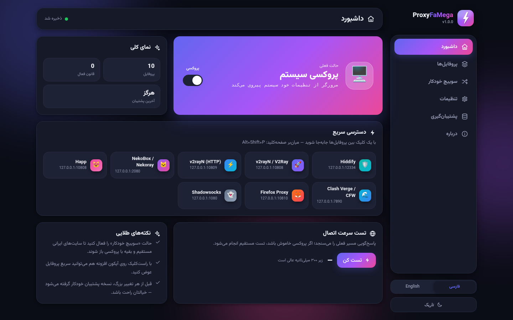

<div dir="rtl" align="center">

# ⚡ ProxyFaMega

**مدیریت پروکسی مرورگر — فارسی، زیبا و حرفه‌ای**

افزونه‌ای مدرن با طراحی الهام‌گرفته از iOS برای مدیریت پروفایل‌های پروکسی؛ جایگزین زیباتر و سریع‌تر SwitchyOmega / ZeroOmega — ساخته‌شده با ❤️ برای فارسی‌زبان‌ها.

  

</div>

<p align="center">
  
  
</p>
<p align="center">
  
  
</p>

## ✨ امکانات

- 🇮🇷 **فارسی پیش‌فرض و کامل (راست‌به‌چپ)** + English — با فونت زیبای **وزیرمتن**
- 🎨 **۸ تم رنگی iOS-سبک** (آورورا، غروب، اقیانوس، نعنایی، آب‌نباتی، طلایی، نیمه‌شب، نئون) + **حالت شب خودکار**
- 🚀 **۱۰ پروفایل آماده** با پورت‌های پیش‌فرض:

| برنامه | پورت | پروتکل |
|---|---|---|
| Hiddify | `12334` | Mixed (SOCKS5/HTTP) |
| v2rayN / V2Ray | `10808` (HTTP: `10809`) | SOCKS5 |
| NekoBox / Nekoray | `2080` | Mixed |
| Happ | `10808` | SOCKS5 |
| Clash Verge / CFW | `7890` | Mixed |
| Firefox Proxy | `10810` | سفارشی |
| Shadowsocks | `1080` | SOCKS5 |
| Tor | `9050` | SOCKS5 |
| Psiphon | `8080` | HTTP |

- 🔀 **سوییچ خودکار هوشمند** با قوانین دامنه/آدرس/Regex + تست‌کننده زنده + پیش‌تنظیم آماده **«ایران مستقیم، بقیه با پروکسی»** (همه `*.ir` و سایت‌های معروف ایرانی مستقیم)
- 💾 **بکاپ حرفه‌ای**: رمزداری AES-256، اسنپ‌شات خودکار (تا ۱۰ نسخه)، **درون‌ریزی مستقیم از ZeroOmega / SwitchyOmega**
- 📝 **هر تنظیم با توضیح و مثال** — کاربر تازه‌کار هم همه‌چیز را می‌فهمد
- ⌨️ میان‌بر `Alt+Shift+P` برای پروفایل بعدی، منوی راست‌کلیک، نشان رنگی روی آیکون، تست سرعت اتصال
- 🔒 **ذخیره خودکار** همه تغییرات + همگام‌سازی اختیاری بین دستگاه‌ها
- 🕵️ **بدون جمع‌آوری داده** — همه‌چیز فقط روی دستگاه شما

<p align="center"> </p>

## 📥 نصب

### گوگل کروم / اج / بریو
1. فایل `ProxyFaMega-v1.0.0-chrome.zip` را باز کنید (Unzip)
2. به `chrome://extensions` بروید
3. حالت **Developer mode** را روشن کنید
4. روی **Load unpacked** کلیک و پوشه `chrome` را انتخاب کنید

> برای اج دقیقاً همین مراحل در `edge://extensions` — یا از بسته `edge` استفاده کنید.

### فایرفاکس
1. به `about:debugging#/runtime/this-firefox` بروید
2. **Load Temporary Add-on…** را بزنید و فایل `manifest.json` داخل پوشه `firefox` را انتخاب کنید

## 🛠️ ساخت از سورس

```bash
git clone https://github.com/YOUR-USERNAME/ProxyFaMega.git
cd ProxyFaMega
python3 scripts/build.py     # → dist/ProxyFaMega-v1.0.0-{chrome,firefox,edge}.zip
node test/logic_test.js      # تست‌های منطق و PAC
```

نیازمندی: فقط پایتون ۳.۶+ و نود — بدون هیچ پکیج خارجی.

## 🎬 پیش‌نمایش بدون نصب

فایل‌های `options/options.html` و `popup/popup.html` را مستقیم در مرورگر باز کنید؛ افزونه در **حالت دمو** با داده نمونه اجرا می‌شود:

```
options/options.html?view=auto&mode=dark&lang=en
```

## ⌨️ میان‌برها

| عمل | کلید |
|---|---|
| پروفایل بعدی | `Alt + Shift + P` |
| پروفایل قبلی | `Alt + Shift + O` |

## 🔄 مهاجرت از ZeroOmega

صفحه **پشتیبان‌گیری → بازیابی** → فایل خروجی JSON از ZeroOmega/SwitchyOmega را رها کنید؛ پروفایل‌ها و قوانین سوییچ خودکار به‌صورت خودکار منتقل می‌شوند.

## 🤝 سپاس‌گزاری

- [ZeroOmega](https://github.com/zero-peak/ZeroOmega) — الهام‌بخش این پروژه
- [SwitchyOmega](https://github.com/FelisCatus/SwitchyOmega) — افزونه کلاسیک و بزرگ مدیریت پروکسی
- [Vazirmatn](https://github.com/rastikerdar/vazirmatn) فونت فارسی [راستی‌کردار](https://github.com/rastikerdar)

## 📄 مجوز

[MIT](LICENSE) — آزاد برای استفاده، تغییر و انتشار.

---

<div dir="ltr" align="center">

## ⚡ ProxyFaMega (English)

A modern, iOS-inspired proxy manager for your browser — Persian-first (RTL), bilingual (FA/EN), with 8 gorgeous themes, auto dark mode, Vazirmatn font, 10 ready-made profiles (Hiddify 12334, v2rayN 10808, NekoBox 2080, Happ, Clash 7890…), smart auto-switch rules with a live URL tester and a one-click "Iran direct" preset, professional backup (AES-256 encryption, auto snapshots, ZeroOmega/SwitchyOmega import), every setting documented with examples, keyboard shortcuts, autosave and zero telemetry.

**Build:** `python3 scripts/build.py` → Chrome (MV3), Edge (MV3) & Firefox (MV2) packages in `dist/`.

</div>
