<p align="center">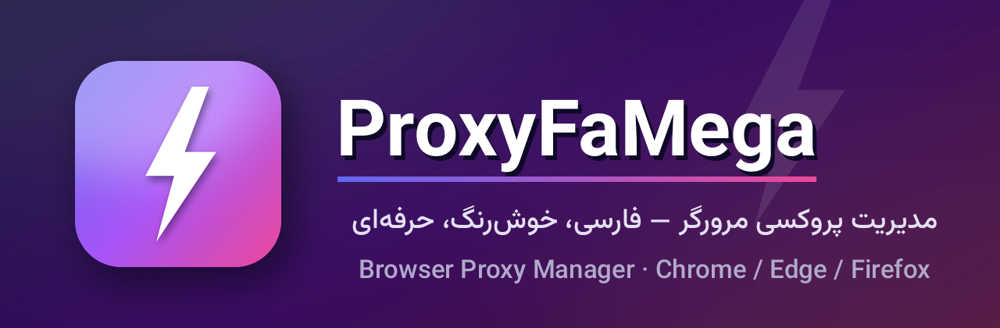</p>

<div align="center">

**ProxyFaMega** — مدیریت پروفایل‌های پروکسی مرورگر | Persian-first bilingual proxy profile manager

    

**فارسی** · [English ↓](#english)

</div>

---

<div dir="rtl">

## فارسی

**ProxyFaMega** یک مدیر پروفایل پروکسی برای مرورگر است: فارسی‌محور و راست‌به‌چپ، دوزبانه (فارسی/انگلیسی)، با رابط کاربری جمع‌وجور به سبک iOS — و بدون هیچ جمع‌آوری داده. جایگزینی ساده‌تر و سریع‌تر برای SwitchyOmega / ZeroOmega که با پروفایل‌های آمادهٔ Hiddify، v2rayN، NekoBox، Happ، Clash، Tor، Psiphon و… کار می‌کند و ترافیک را به کلاینت محلی شما می‌فرستد.

> **v2.2.0 — پروفایل Firefox برگشت:** پروفایل همیشگی «Firefox» (SOCKS5 `127.0.0.1:10810`) دوباره در فهرست آماده است — یک پروفایل معمولی بدون هیچ ماژول VPN؛ هر کلاینت محلی که روی پورت 10810 گوش بدهد، مرورگر را از آن عبور می‌دهد.
>
> **v2.1.0 — نسخهٔ نهایی بدون VPN:** ماژول 100riVPN که در 2.0.x وجود داشت به‌طور کامل حذف شد؛ ProxyFaMega حالا یک ابزار تک‌منظورهٔ مدیریت پروکسی است. توکن‌های قدیمی در اولین اجرا خودکار پاک می‌شوند و بکاپ‌های قدیمی بدون خطا باز می‌شوند (بخش VPN نادیده گرفته می‌شود). جزئیات: [CHANGELOG](CHANGELOG.md)

### گالری

<p align="center">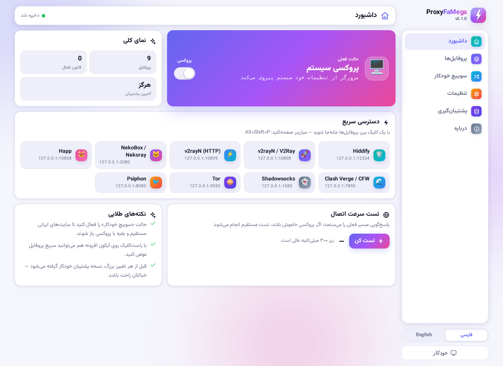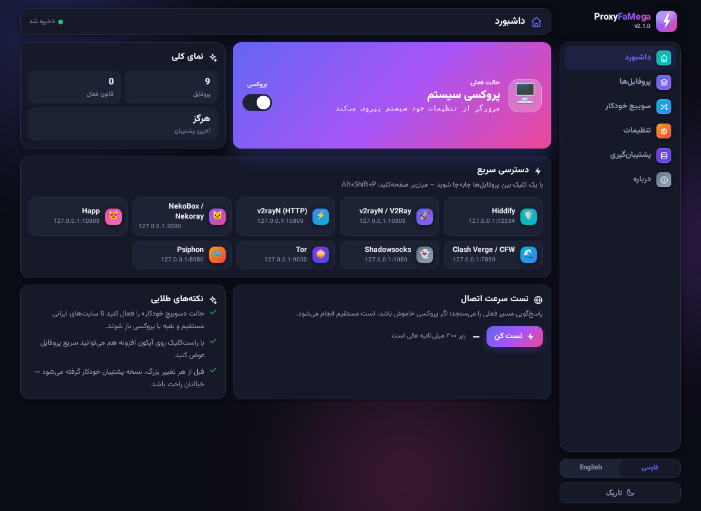</p>
<p align="center">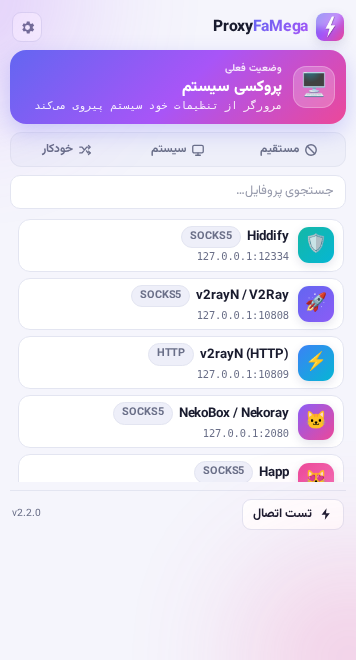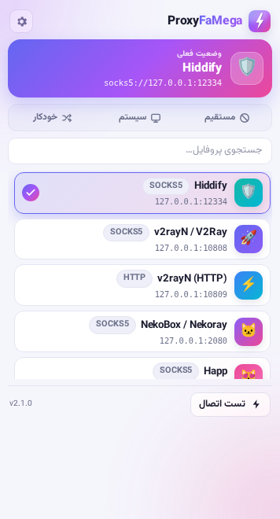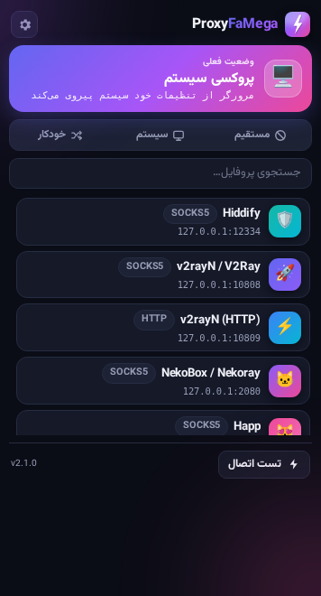</p>
<p align="center">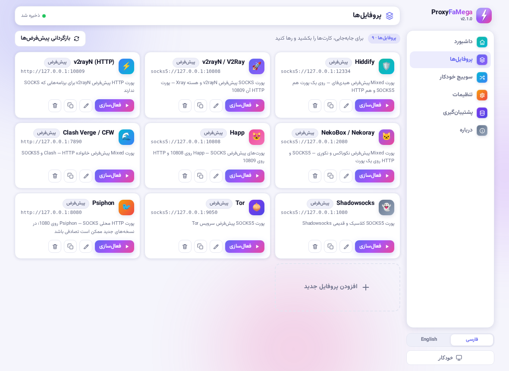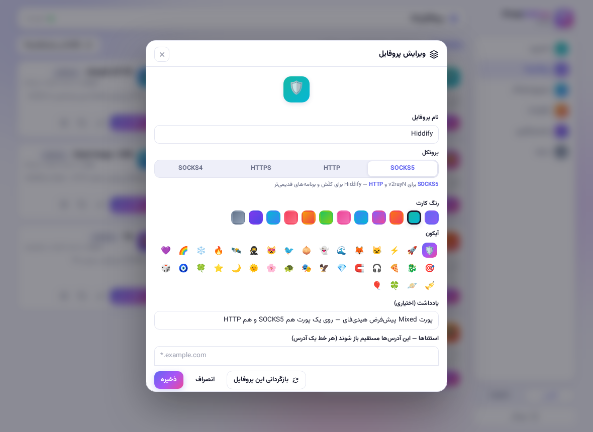</p>
<p align="center">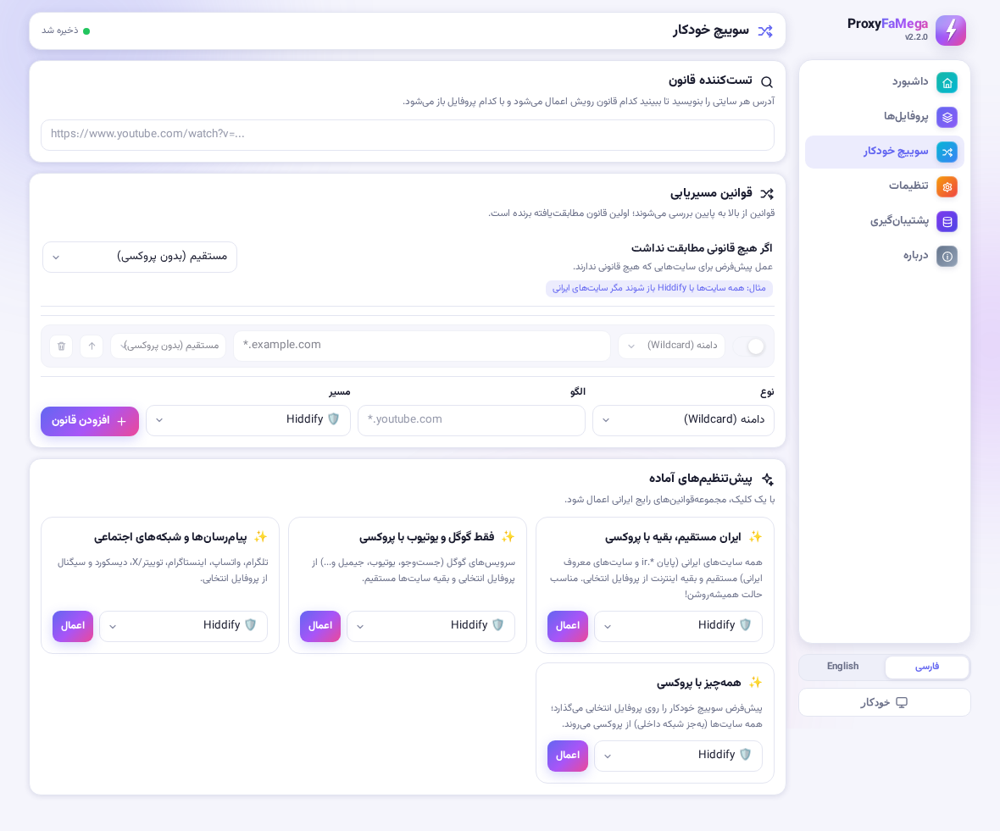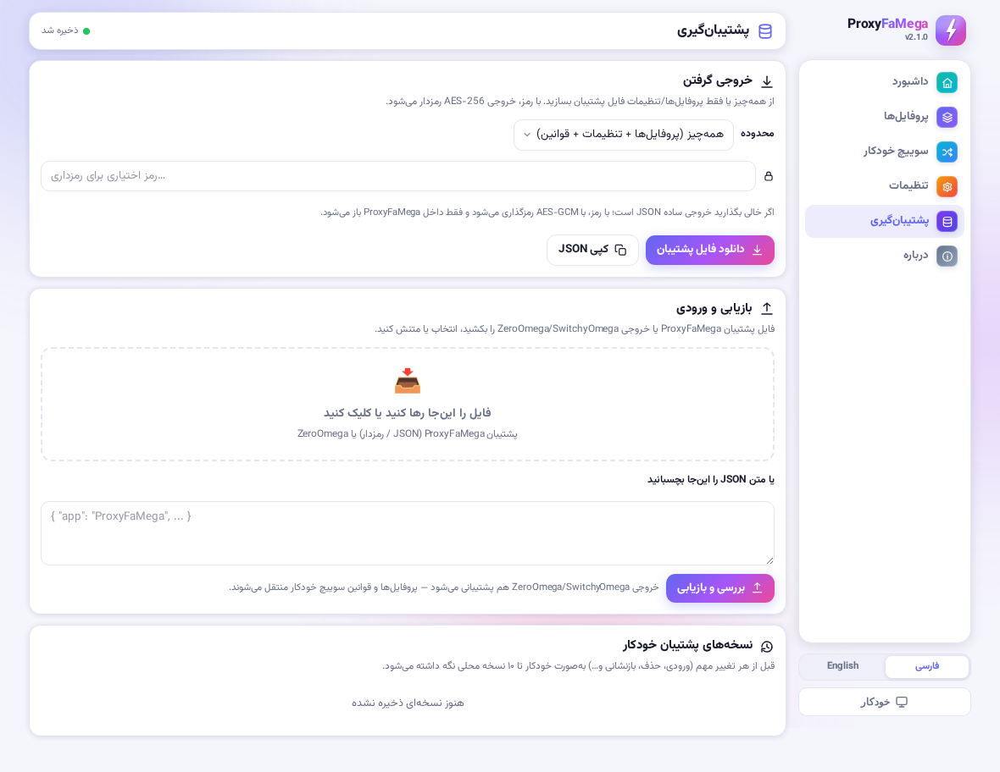</p>
<p align="center">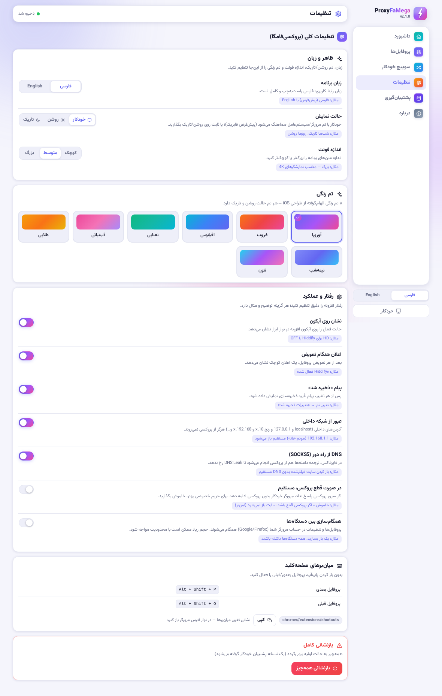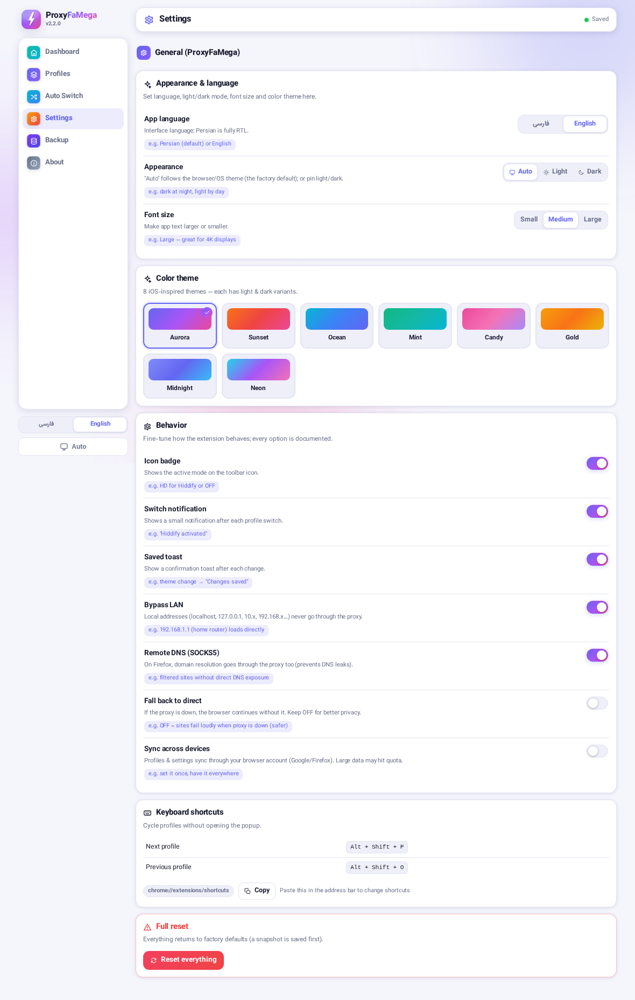</p>

### امکانات

- **پروفایل‌ها** — ۱۰ پروفایل آماده + هر تعداد پروفایل دلخواه (SOCKS5 / SOCKS4 / HTTP / HTTPS)، تست اتصال، منوی راست‌کلیک، نشان رنگی وضعیت روی آیکون
- **سوییچ خودکار** — قوانین دامنه / URL / Regex با تست‌کنندهٔ زنده و ۴ پیش‌تنظیم یک‌کلیکی، از جمله «ایران مستقیم، بقیه با پروکسی»
- **بکاپ حرفه‌ای** — رمزداری AES-256-GCM، اسنپ‌شات خودکار تا ۱۰ نسخه، درون‌ریزی مستقیم از ZeroOmega / SwitchyOmega، همگام‌سازی اختیاری بین دستگاه‌ها از طریق حساب مرورگر
- **ظاهر** — ۸ تم رنگی، حالت روشن/تاریک/خودکار (پیش‌فرض کارخانه: تبعیت از تم مرورگر)، فونت وزیرمتن در ۴ وزن، سه اندازهٔ فونت
- **زبان** — فارسی پیش‌فرض + انگلیسی؛ تعویض آنی بدون راه‌اندازی مجدد
- **میان‌برها** — <kbd>Alt</kbd>+<kbd>Shift</kbd>+<kbd>P</kbd> پروفایل بعدی، <kbd>Alt</kbd>+<kbd>Shift</kbd>+<kbd>O</kbd> پروفایل قبلی
- **حریم خصوصی** — صفر تلمتری؛ همه‌چیز روی دستگاه شما می‌ماند ([PRIVACY.md](PRIVACY.md))

### پروفایل‌های آماده

| برنامه | پورت | پروتکل |
|---|---|---|
| Hiddify | `12334` | SOCKS5 |
| v2rayN / V2Ray | `10808` | SOCKS5 |
| v2rayN (HTTP) | `10809` | HTTP |
| NekoBox / Nekoray | `2080` | SOCKS5 |
| Happ | `10808` | SOCKS5 |
| Clash Verge / CFW | `7890` | HTTP |
| Firefox | `10810` | SOCKS5 |
| Shadowsocks | `1080` | SOCKS5 |
| Tor | `9050` | SOCKS5 |
| Psiphon | `8080` | HTTP |

### نصب

بستهٔ واحد [Releases](https://github.com/100ri-ir/ProxyFaMega/releases) (`ProxyFaMega-v2.2.0.zip`) شامل `Extention/` با سه بیلد آماده + `Source/` کامل است.

**Chrome / Brave / Edge**

1. زیپ را باز کنید و به `Extention/chrome` بروید
2. `chrome://extensions` را باز کنید و **Developer mode** را روشن کنید
3. **Load unpacked** ← پوشهٔ `chrome` را انتخاب کنید

**Firefox**

1. به `about:debugging#/runtime/this-firefox` بروید
2. **Load Temporary Add-on…** ← فایل `manifest.json` داخل `Extention/firefox` را انتخاب کنید

> بیلد Edge دقیقاً همین مراحل را در `edge://extensions` با پوشهٔ `edge` دارد.

### ساخت از سورس

```bash
git clone https://github.com/100ri-ir/ProxyFaMega.git
cd ProxyFaMega
node test/logic_test.js && node test/background_smoke_test.js   # تست‌ها
python3 scripts/build.py                                        # بیلد
```

خروجی: `dist/ProxyFaMega-v2.2.0.zip` با ساختار `Extention/{chrome,edge,firefox}` + `Source/`.
نیازمندی: Python 3.6+ و Node — بدون هیچ وابستگی خارجی.

### پیش‌نمایش بدون نصب (حالت دمو)

فایل‌های `src/options/options.html` و `src/popup/popup.html` را مستقیم در مرورگر باز کنید؛ افزونه با دادهٔ نمونه اجرا می‌شود:

```
options.html?view=auto&mode=dark&lang=en
popup.html?mode=dark&lang=en
```

### میان‌برها

| عمل | کلید |
|---|---|
| پروفایل بعدی | <kbd>Alt</kbd> + <kbd>Shift</kbd> + <kbd>P</kbd> |
| پروفایل قبلی | <kbd>Alt</kbd> + <kbd>Shift</kbd> + <kbd>O</kbd> |

### سوییچ خودکار

- قوانین **دامنه** (`*.example.com`)، **URL** (آدرس کامل یا الگو) و **Regex** با اولویت از بالا به پایین؛ هر قاعده فعال/غیرفعال
- تست‌کنندهٔ زنده: هر URL را بدهید، می‌بینید کدام قاعده و کدام خروجی (پروکسی/مستقیم) اعمال می‌شود
- ۴ پیش‌تنظیم آماده: «ایران مستقیم، بقیه با پروکسی» (همهٔ `*.ir` و ۱۵+ سایت ایرانی معروف مستقیم)، «فقط گوگل و یوتیوب»، «پیام‌رسان‌ها و شبکه‌های اجتماعی»، «همه‌چیز با پروکسی»
- در کروم/اج از PAC تولیدشده و در فایرفاکس از `proxy.onRequest` استفاده می‌شود

### بکاپ و مهاجرت

- خروجی کامل/جزیی + رمزداری AES-256-GCM + اسنپ‌شات خودکار (تا ۱۰ نسخه) پیش از تغییرات مهم
- **مهاجرت از ZeroOmega / SwitchyOmega**: صفحهٔ بکاپ → بازیابی ← فایل JSON را رها کنید؛ پروفایل‌ها و قوانین سوییچ خودکار منتقل می‌شوند (حالت ادغام یا جایگزینی)
- بکاپ‌های v2.0.x (با حساب‌های VPN) بدون خطا باز می‌شوند؛ دادهٔ VPN با یادداشت شفاف نادیده گرفته می‌شود

### سؤالات رایج

**پروفایل «Firefox» (10810) چیست؟**
یک پروفایل آمادهٔ معمولی به نشانی `127.0.0.1:10810` — همان پروفایلی که از نسخه‌های اول داشتنید و در v2.2.0 برگشت. ProxyFaMega ترافیک مرورگر را فقط به این پورت محلی می‌فرستد؛ هر برنامهٔ خارجی که SOCKS5 روی 10810 بدهد (مثلاً کلاینت دسکتاپ خودتان) تونل واقعی را برقرار می‌کند. اگر پورت برنامهٔ شما فرق دارد، در صفحهٔ پروفایل‌ها ویرایشش کنید.

**ماژول VPN چی شد؟**
نسخه‌های 2.0.x ماژول اختیاری 100riVPN (VPN داخلی فایرفاکس) داشتند. یک افزونهٔ مرورگر نمی‌تواند خودش تونل را باز کند (CONNECT با توکن Bearer در جاوااسکریپت ممنوع است)، بنابراین ماژول در v2.1.0 کامل حذف شد تا ابزار ساده و تک‌منظوره باشد. توکن‌های باقی‌مانده در اولین اجرا پاک می‌شوند؛ بکاپ‌های قدیمی سالم باز می‌شوند.

**کدام مرورگرها؟**
Chrome 111+، Edge (هر دو MV3) و Firefox 115+ (MV2) — با سه بیلد جدا در همان بسته.

**داده‌ای جمع می‌شود؟**
خیر. بدون تحلیل، بدون حساب کاربری، بدون سرور. تنها درخواست شبکه‌ای (اختیاری و با دست خودتان) تست اتصال به `gstatic.com` / `cp.cloudflare.com` است. جزئیات: [PRIVACY.md](PRIVACY.md)

### ساختار پروژه

```
├─ src/
│  ├─ background/    chromium.js (MV3 service worker) · firefox.js (MV2)
│  ├─ popup/         پاپ‌آپ ۳۵۶px
│  ├─ options/       داشبورد · پروفایل‌ها · سوییچ خودکار · بکاپ · تنظیمات · درباره
│  ├─ common/        storage · matcher/PAC · themes · i18n · defaults · constants
│  ├─ manifests/     chrome.json · firefox.json
│  ├─ assets/        فونت وزیرمتن · آیکون‌ها
│  └─ _locales/      fa · en
├─ test/            logic_test.js · background_smoke_test.js  (node)
├─ scripts/         build.py · gen_icons.py · check_i18n.py  (پایتون استاندارد)
├─ screenshots/     گالری این README
└─ .github/         CI · Release
```

### مشارکت

[CONTRIBUTING.md](CONTRIBUTING.md) را ببینید — Pull request خوش‌آمد است؛ تست‌ها را سبز نگه دارید و متن‌ها را جفت دو زبان اضافه کنید.

### سپاس‌گزاری

- [ZeroOmega](https://github.com/zero-peak/ZeroOmega) و [SwitchyOmega](https://github.com/FelisCatus/SwitchyOmega) — الهام‌بخش این پروژه
- [Vazirmatn](https://github.com/rastikerdar/vazirmatn) — فونت فارسی ([راستی‌کردار](https://github.com/rastikerdar))

### مجوز

[MIT](LICENSE) — آزاد برای استفاده، تغییر و انتشار.

</div>

---

## English

[فارسی ↑](#فارسی) · **English**

**ProxyFaMega** is a browser proxy-profile manager: Persian-first, fully RTL, bilingual (Persian/English), with a compact iOS-style UI — and zero telemetry. A simpler, faster alternative to SwitchyOmega / ZeroOmega that ships ready-made profiles for Hiddify, v2rayN, NekoBox, Happ, Clash, Tor, Psiphon… and routes your browser traffic to your own local proxy client.

> **v2.2.0 — the Firefox profile is back:** the classic "Firefox" profile (SOCKS5 `127.0.0.1:10810`) returns to the ready-made list — a plain profile with no VPN module; any local client listening on port 10810 carries the browser traffic through it.
>
> **v2.1.0 — final VPN-free:** the optional 100riVPN module from 2.0.x was removed entirely; ProxyFaMega is now a single-purpose proxy manager. Legacy tokens are wiped on first run and old backups open cleanly (the VPN part is skipped). Details: [CHANGELOG](CHANGELOG.md)

### Gallery

<p align="center">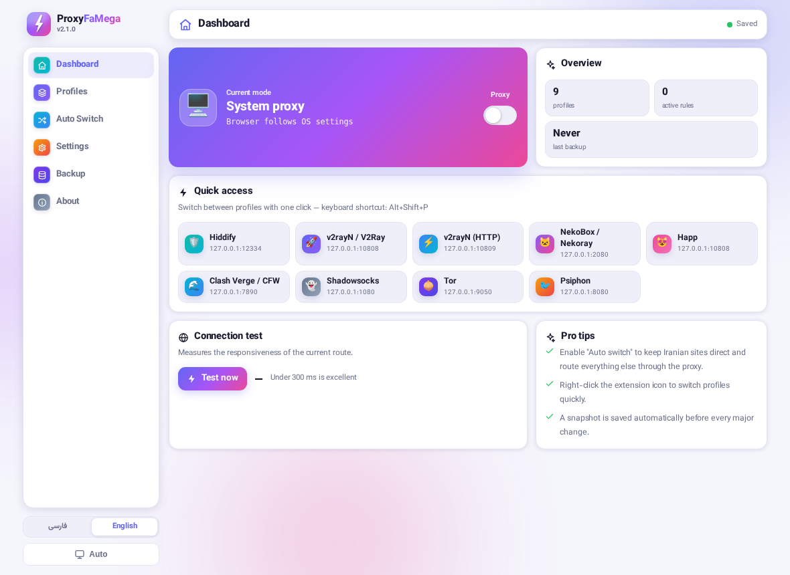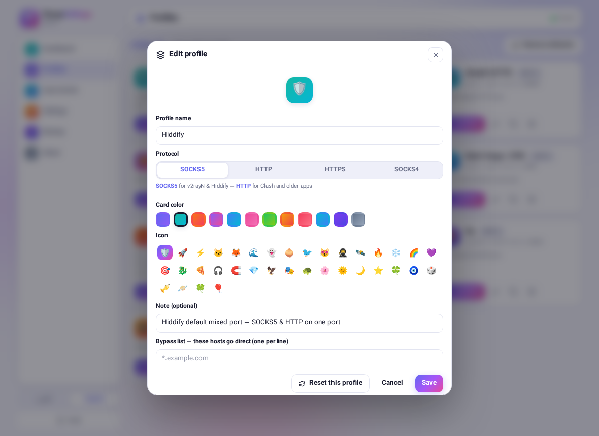</p>
<p align="center">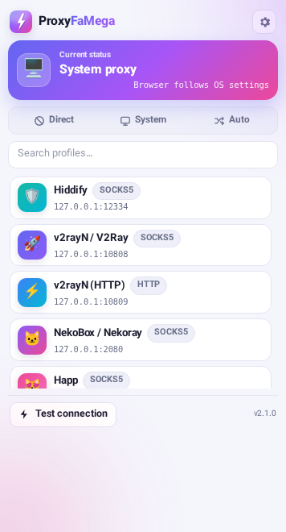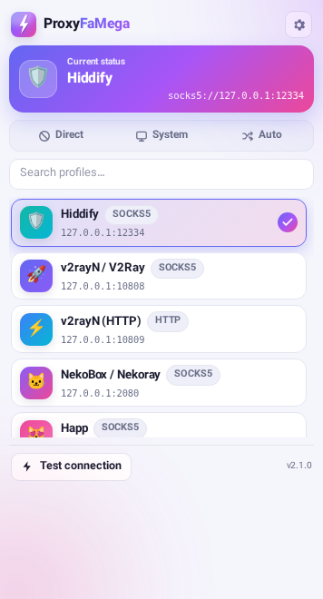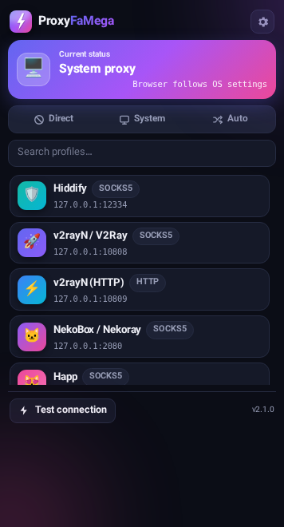</p>
<p align="center">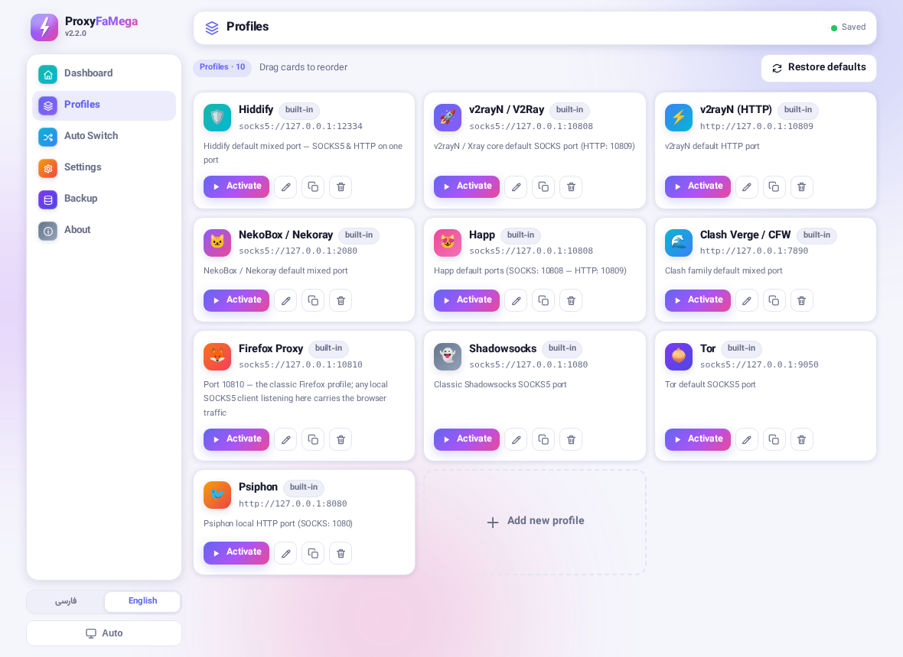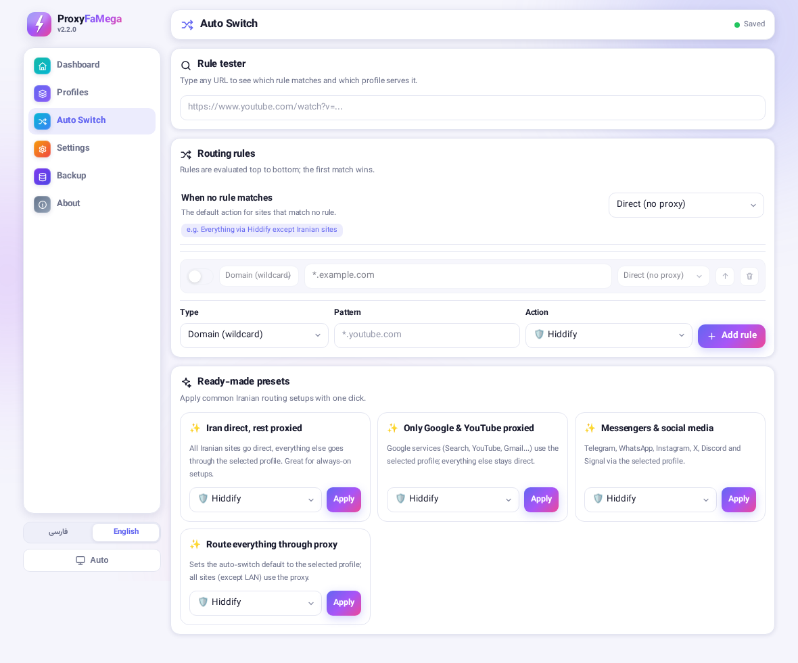</p>
<p align="center">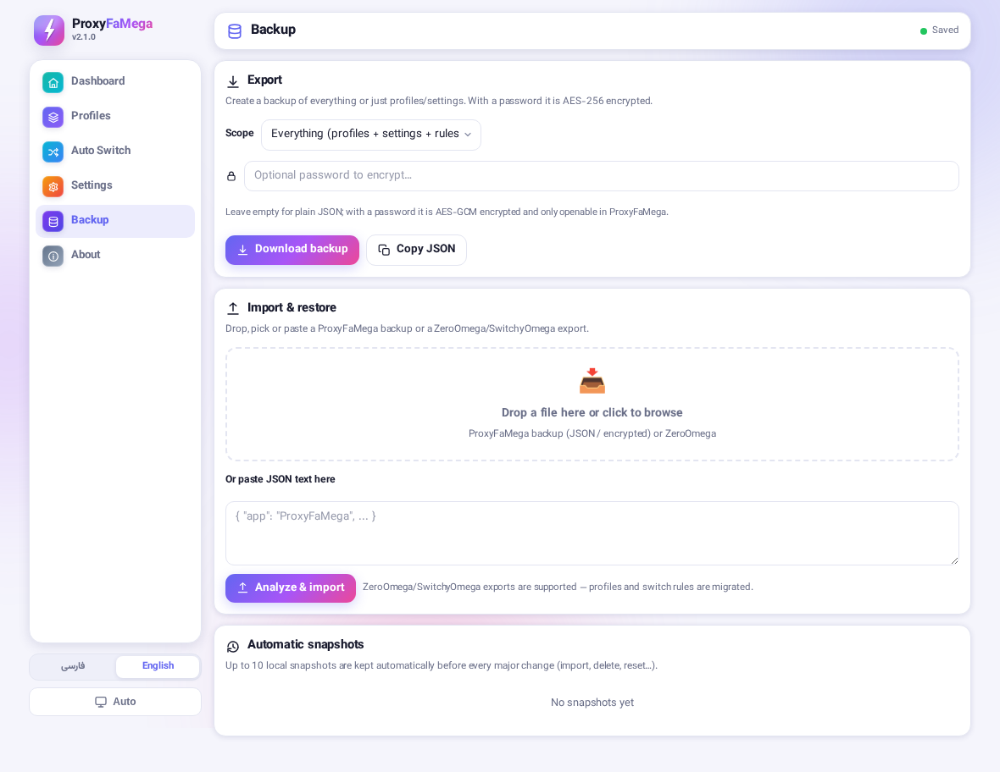</p>

### Features

- **Profiles** — 10 ready-made profiles + unlimited custom ones (SOCKS5 / SOCKS4 / HTTP / HTTPS), connection test, right-click menu, colored status badge
- **Auto switch** — domain / URL / regex rules with a live tester and 4 one-click presets, including "Iran direct, rest proxied"
- **Pro backup** — AES-256-GCM encryption, automatic snapshots (up to 10), direct ZeroOmega / SwitchyOmega import, optional cross-device sync through your browser account
- **Look & feel** — 8 color themes, light/dark/auto appearance (factory default: follow the browser theme), Vazirmatn font in 4 weights, three font sizes
- **Language** — Persian by default + English, switchable instantly
- **Shortcuts** — <kbd>Alt</kbd>+<kbd>Shift</kbd>+<kbd>P</kbd> next profile, <kbd>Alt</kbd>+<kbd>Shift</kbd>+<kbd>O</kbd> previous
- **Privacy** — zero telemetry; everything stays on your device ([PRIVACY.md](PRIVACY.md))

### Ready-made profiles

| App | Port | Protocol |
|---|---|---|
| Hiddify | `12334` | SOCKS5 |
| v2rayN / V2Ray | `10808` | SOCKS5 |
| v2rayN (HTTP) | `10809` | HTTP |
| NekoBox / Nekoray | `2080` | SOCKS5 |
| Happ | `10808` | SOCKS5 |
| Clash Verge / CFW | `7890` | HTTP |
| Firefox | `10810` | SOCKS5 |
| Shadowsocks | `1080` | SOCKS5 |
| Tor | `9050` | SOCKS5 |
| Psiphon | `8080` | HTTP |

### Install

The single [Releases](https://github.com/100ri-ir/ProxyFaMega/releases) package (`ProxyFaMega-v2.2.0.zip`) contains `Extention/` with three ready builds + the full `Source/`.

**Chrome / Brave / Edge**

1. Unzip and open `Extention/chrome`
2. Go to `chrome://extensions`, enable **Developer mode**
3. **Load unpacked** ← select the `chrome` folder

**Firefox**

1. Go to `about:debugging#/runtime/this-firefox`
2. **Load Temporary Add-on…** ← pick `manifest.json` inside `Extention/firefox`

> The Edge build follows the same steps at `edge://extensions` with the `edge` folder.

### Build from source

```bash
git clone https://github.com/100ri-ir/ProxyFaMega.git
cd ProxyFaMega
node test/logic_test.js && node test/background_smoke_test.js   # tests
python3 scripts/build.py                                        # build
```

Output: `dist/ProxyFaMega-v2.2.0.zip` with `Extention/{chrome,edge,firefox}` + `Source/`.
Requirements: Python 3.6+ and Node — no external dependencies.

### Preview without installing (demo mode)

Open `src/options/options.html` and `src/popup/popup.html` directly in a browser; the extension runs with sample data:

```
options.html?view=auto&mode=dark&lang=en
popup.html?mode=dark&lang=en
```

### Shortcuts

| Action | Keys |
|---|---|
| Next profile | <kbd>Alt</kbd> + <kbd>Shift</kbd> + <kbd>P</kbd> |
| Previous profile | <kbd>Alt</kbd> + <kbd>Shift</kbd> + <kbd>O</kbd> |

### Auto switch

- **Domain** (`*.example.com`), **URL** and **regex** rules, priority top-down, each toggleable
- Live tester: give it any URL and see which rule matches and which route (proxy/direct) applies
- 4 presets: "Iran direct, rest proxied" (all `*.ir` + 15+ well-known Iranian sites direct), "Google & YouTube only", "Messengers & social", "Route everything"
- Chromium/Edge use a generated PAC script; Firefox uses `proxy.onRequest`

### Backup & migration

- Full/partial export + AES-256-GCM encryption + automatic snapshots (up to 10) before major changes
- **Migrating from ZeroOmega / SwitchyOmega**: Backup → Restore, drop the JSON file; profiles and auto-switch rules transfer automatically (merge or replace mode)
- v2.0.x backups (carrying VPN accounts) open without errors; the VPN data is skipped with a clear note

### FAQ

**What is the "Firefox" profile (10810)?**
A plain ready-made profile pointing at `127.0.0.1:10810` — the same profile you had in the early releases, restored in v2.2.0. ProxyFaMega only forwards the browser's traffic to that local port; whatever external app serves SOCKS5 there (e.g. your own desktop client) does the actual tunneling. If your app uses a different port, just edit the profile.

**What happened to the VPN module?**
The 2.0.x releases shipped an optional 100riVPN module (Firefox's built-in VPN). A browser extension cannot open the tunnel by itself (JavaScript is not allowed to issue authenticated CONNECT requests), so the module was removed entirely in v2.1.0. Leftover tokens are wiped on first run; old backups still import cleanly.

**Which browsers?**
Chrome 111+, Edge (both MV3) and Firefox 115+ (MV2) — three separate builds in one package.

**Does it collect data?**
No. No analytics, no accounts, no servers. The only network request (optional, user-triggered) is the connection test against `gstatic.com` / `cp.cloudflare.com`. Details: [PRIVACY.md](PRIVACY.md)

### Project structure

```
├─ src/
│  ├─ background/    chromium.js (MV3 service worker) · firefox.js (MV2)
│  ├─ popup/          356px popup
│  ├─ options/        dashboard · profiles · auto-switch · backup · settings · about
│  ├─ common/         storage · matcher/PAC · themes · i18n · defaults · constants
│  ├─ manifests/      chrome.json · firefox.json
│  ├─ assets/         Vazirmatn fonts · icons
│  └─ _locales/       fa · en
├─ test/            logic_test.js · background_smoke_test.js  (node)
├─ scripts/         build.py · gen_icons.py · check_i18n.py  (stdlib python)
├─ screenshots/     this README's gallery
└─ .github/         CI · Release
```

### Contributing

See [CONTRIBUTING.md](CONTRIBUTING.md) — pull requests are welcome; keep the tests green and add UI strings in both languages.

### Acknowledgments

- [ZeroOmega](https://github.com/zero-peak/ZeroOmega) and [SwitchyOmega](https://github.com/FelisCatus/SwitchyOmega) — the inspiration for this project
- [Vazirmatn](https://github.com/rastikerdar/vazirmatn) — the Persian font by [rastikerdar](https://github.com/rastikerdar)

### License

[MIT](LICENSE) — free to use, modify and redistribute.
