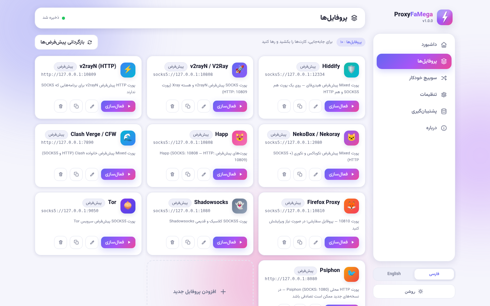
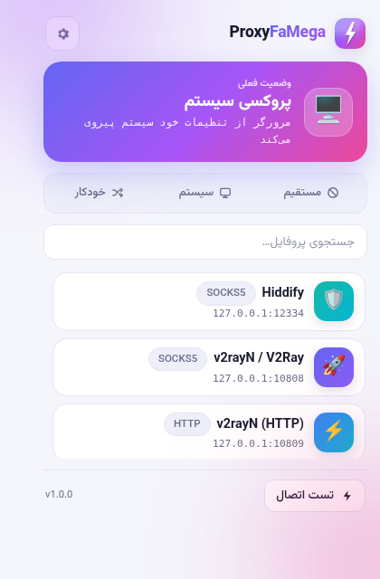
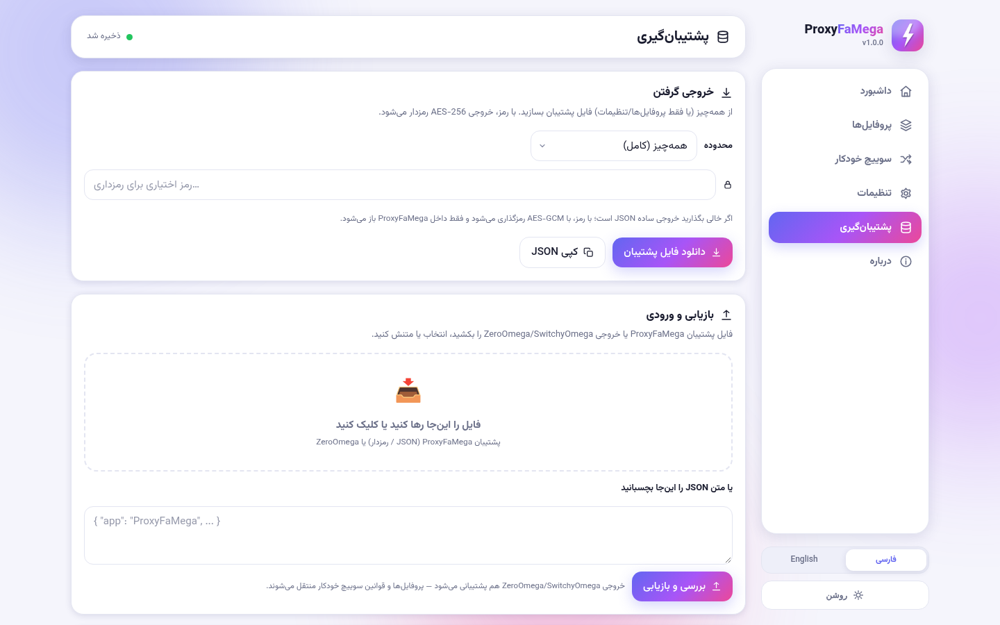
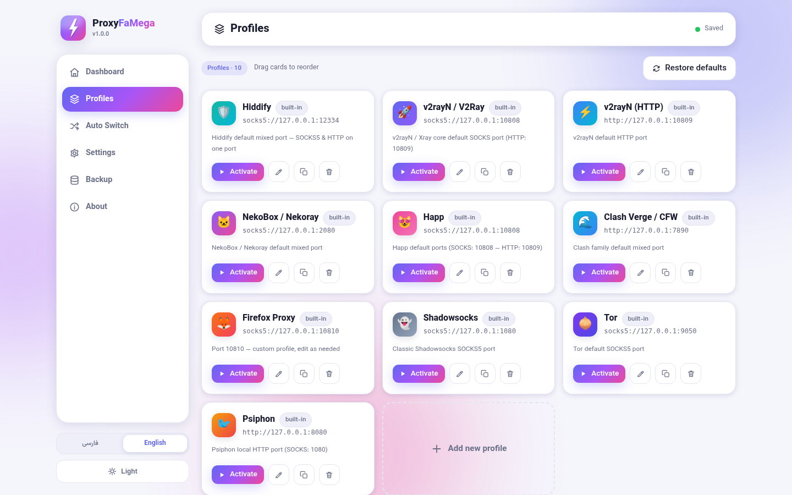
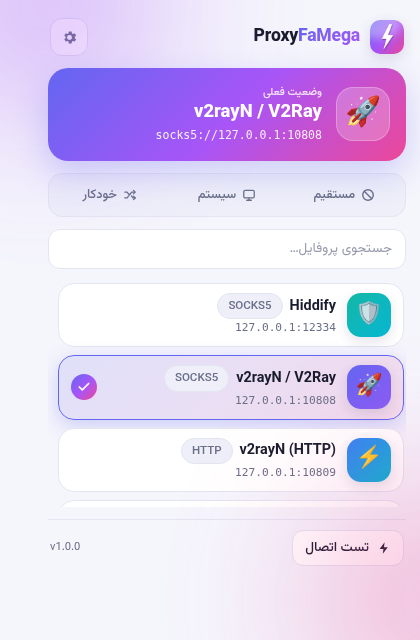

<div dir="rtl" align="center">


# ⚡ پروکسی‌فا مگا

**مدیریت پروکسی مرورگر — فارسی، خوش‌رنگ و حرفه‌ای**

افزونه‌ای مدرن با طراحی الهام‌گرفته از iOS برای مدیریت پروفایل‌های پروکسی؛ بازطراحیِ ایرانی‌شده و فارسی‌شدهٔ ایدهٔ [ZeroOmega](https://github.com/zero-peak/ZeroOmega) — با ۱۰ پروفایل آماده (Hiddify، v2rayN، NekoBox، Happ، Clash و…)، سوییچ خودکار هوشمند با پیش‌تنظیمِ **«ایران مستقیم، بقیه با پروکسی»** و ۸ تم رنگی خوشگل.

ساخته‌شده با ❤️ و ☕ توسط **[100ri.ir](https://github.com/100ri-ir)** برای کاربران فارسی‌زبان

</div>

<div dir="rtl" align="center">

    

[](https://github.com/100ri-ir/ProxyFaMega/releases/latest) [](https://github.com/100ri-ir/ProxyFaMega/stargazers) [](https://github.com/100ri-ir/ProxyFaMega/actions/workflows/release.yml)

**[📥 دانلود از Releases](https://github.com/100ri-ir/ProxyFaMega/releases/latest)** · **[✨ امکانات](#-امکانات)** · **[📥 نصب](#-نصب)** · **[🎬 پیش‌نمایش بدون نصب](#-پیشنمایش-بدون-نصب)** · **[🇬🇧 English](#-proxyfamega-english)**

</div>

<div dir="rtl">

---

## 💡 چرا ProxyFaMega؟

هر ایرانی که با Hiddify یا v2rayN یا نکوباکس کار می‌کند، وسط کارش به یک مشکل خورده: **تغییر سریع پروکسیِ مرورگر**. پروژه‌های قدیمی مثل SwitchyOmega یا جانشینش ZeroOmega عالی‌اند، ولی انگلیسی‌اند، قیافه‌شان دهه‌ای است و برای پروفایل‌های رایج ایرانی هیچ پیش‌فرضی ندارند.

ProxyFaMega همان قدرت را با **رابط کاملاً فارسی، راست‌به‌چپ و iOS-سبک** می‌آورد؛ با پورت‌های پیش‌فرضِ برنامه‌هایی که همین امروز استفاده می‌کنید، پیش‌تنظیم‌های آمادهٔ ایرانی و جزوه‌ای از توضیح و مثال زیرِ هر تنظیم — طوری که حتی اگر تازه‌کار هم باشید، همه‌چیز را می‌فهمید.

## ✨ امکانات

- 🇮🇷 **فارسی پیش‌فرض و کامل (راست‌به‌چپ)** + English — با فونت زیبای **[وزیرمتن](https://github.com/rastikerdar/vazirmatn)** و جابه‌جایی زبان در لحظه
- 🎨 **۸ تم رنگی iOS-سبک** (آورورا، غروب، اقیانوس، نعنایی، آب‌نباتی، طلایی، نیمه‌شب، نئون) + **حالت شب خودکار** هماهنگ با سیستم‌عامل
- 🚀 **۱۰ پروفایل آماده** با پورت‌های پیش‌فرض — جدول کامل پایین‌تر ⬇️
- 🔀 **سوییچ خودکار هوشمند** با قوانین دامنه/آدرس/Regex + **تست‌کنندهٔ زندهٔ آدرس** + ۴ پیش‌تنظیم آماده، از جمله **«ایران مستقیم، بقیه با پروکسی»** (همهٔ `*.ir` و سایت‌های معروف ایرانی مثل دیجی‌کالا، آپارات، ترب، وارزش۳ و… مستقیم می‌روند)
- 💾 **بکاپ حرفه‌ای**: خروجی رمزداری‌شده با AES-256-GCM، اسنپ‌شات خودکار (تا ۱۰ نسخه) و **درون‌ریزی مستقیم از ZeroOmega / SwitchyOmega**
- 📝 **هر تنظیم با توضیح فارسی و مثال کاربردی** — بدون گیج‌شدن!
- ⌨️ میان‌بر `Alt+Shift+P` برای پروفایل بعدی، منوی راست‌کلیک روی آیکون، نشان رنگی وضعیت، تست سرعت اتصال
- 🔒 **ذخیرهٔ خودکار** همهٔ تغییرات + همگام‌سازی اختیاری بین دستگاه‌ها
- 🕵️ **بدون جمع‌آوری داده** — همه‌چیز فقط روی دستگاه خودتان می‌ماند
- 🧪 **تست‌های منطقی و PAC** — بیلد بدون تستِ سبز منتشر نمی‌شود

## 🚀 ۱۰ پروفایل آماده

| برنامه | پورت | پروتکل |
|---|---:|---|
| Hiddify | `12334` | Mixed (SOCKS5/HTTP) |
| v2rayN / V2Ray | `10808` | SOCKS5 |
| v2rayN (HTTP) | `10809` | HTTP |
| NekoBox / Nekoray | `2080` | Mixed (SOCKS5/HTTP) |
| Happ | `10808` | SOCKS5 (HTTP: `10809`) |
| Clash Verge / CFW | `7890` | Mixed (HTTP/SOCKS5) |
| Firefox Proxy | `10810` | سفارشی |
| Shadowsocks | `1080` | SOCKS5 |
| Tor | `9050` | SOCKS5 |
| Psiphon | `8080` | HTTP (SOCKS: `1080`) |

## 📸 نگاهی به رابط کاربری

<table>
<tr>
<td width="50%"></td>
<td width="50%"></td>
</tr>
<tr>
<td width="50%"></td>
<td width="50%"></td>
</tr>
<tr>
<td width="30%"></td>
<td width="30%"></td>
<td width="30%"></td>
</tr>
</table>

<details>
<summary><b>📸 تصاویر بیشتر</b> (تنظیمات، ویرایشگر پروفایل، نسخهٔ انگلیسی و…)</summary>

<table>
<tr><td width="50%"></td><td width="50%"></td></tr>
<tr><td width="50%"></td><td width="50%"></td></tr>
</table>

</details>

## 📥 نصب

### 🟢 کروم / بریو — و 🔵 اج

1. آخرین نسخه را از [**صفحهٔ Releases**](https://github.com/100ri-ir/ProxyFaMega/releases/latest) دانلود کنید: فایل `ProxyFaMega-v1.0.0-chrome.zip` (برای اج همان بسته یا `edge` مناسب است)
2. فایل ZIP را باز کنید (Extract)
3. به `chrome://extensions` بروید (در اج: `edge://extensions`)
4. حالت **Developer mode** را روشن کنید
5. روی **Load unpacked** کلیک و پوشهٔ حاصل از unzip را انتخاب کنید

### 🦊 فایرفاکس

1. به `about:debugging#/runtime/this-firefox` بروید
2. **Load Temporary Add-on…** را بزنید و فایل `manifest.json` داخل بستهٔ `firefox` را انتخاب کنید

> 💡 نصب موقت فایرفاکس تا بسته‌شدن مرورگر می‌ماند؛ در نسخه‌های بعدی انتشار از طریق فروشگاه افزونه‌ها هم اضافه می‌شود.

## ⌨️ میان‌برها

| عمل | کلید |
|---|---|
| پروفایل بعدی | `Alt + Shift + P` |
| پروفایل قبلی | `Alt + Shift + O` |

## 🎬 پیش‌نمایش بدون نصب

فایل‌های `options/options.html` و `popup/popup.html` را مستقیم در مرورگر باز کنید؛ افزونه در **حالت دمو** با دادهٔ نمونه اجرا می‌شود:

```
options/options.html?view=auto&mode=dark&lang=en
```

پارامترها: `view` (`dashboard` / `profiles` / `auto` / `settings` / `backup` / `about`)، `mode` (`light` / `dark`)، `lang` (`fa` / `en`)، `theme` (مثل `aurora`، `sunset`، `ocean`، `midnight`…)

## 🛠️ ساخت از سورس

```bash
git clone https://github.com/100ri-ir/ProxyFaMega.git
cd ProxyFaMega
python3 scripts/build.py     # → dist/ProxyFaMega-v1.0.0-{chrome,firefox,edge}.zip
node test/logic_test.js      # تست‌های منطق و PAC
python3 scripts/check_i18n.py # سلامت ترجمه‌ها
```

نیازمندی: فقط **پایتون ۳.۶+** و **Node** — بدون هیچ وابستگی خارجی. بسته‌های توزیع هم به‌صورت خودکار در [Releases](https://github.com/100ri-ir/ProxyFaMega/releases) قرار می‌گیرند.

## 🔄 مهاجرت از ZeroOmega / SwitchyOmega

صفحهٔ **پشتیبان‌گیری ← بازیابی** → فایل خروجی JSON از ZeroOmega یا SwitchyOmega را رها کنید؛ پروفایل‌ها و قوانین سوییچ خودکار به‌صورت خودکار با پیش‌نمایش و امکان ادغام/جایگزینی منتقل می‌شوند.

## 🧩 ساختار پروژه

```
ProxyFaMega/
├── src/                  ← سورس اصلی افزونه
│   ├── background/       ← سرویس‌ورکر MV3 (کرومیوم) و موتور پروکسی MV2 (فایرفاکس)
│   ├── common/           ← ثابت‌ها، تم‌ها، i18n، ذخیره‌سازی، موتور قوانین (matcher/PAC)
│   ├── popup/            ← پاپ‌آپ تعویض سریع
│   ├── options/          ← تنظیمات کامل (داشبورد، پروفایل‌ها، سوییچ خودکار، بکاپ…)
│   ├── assets/           ← آیکون‌ها + فونت وزیرمتن (۴ وزن)
│   ├── _locales/         ← پیام‌های بومی‌سازی fa / en
│   └── manifests/        ← مانیفست‌های chrome / firefox
├── scripts/              ← build.py ، gen_icons.py ، check_i18n.py
├── test/                 ← تست‌های منطق و PAC (بدون فریم‌ورک، فقط Node)
├── screenshots/          ← تصاویر رابط کاربری
├── assets/               ← بنر و فایل‌های داکیومنت
└── .github/workflows/    ← بیلد و انتشار خودکار روی تگ
```

## 🗺️ نقشهٔ راه

- [x] نسخهٔ ۱.۰ — داشبورد، پروفایل‌ها، سوییچ خودکار، بکاپ، ۸ تم، دوزبانه
- [ ] انتشار در فروشگاه کروم وب و افزونه‌های فایرفاکس
- [ ] پروفایل‌های آمادهٔ بیشتر + ویرایش گروهی
- [ ] خروجی/درون‌ریزی قوانین با فرمت‌های رایج (Clash، PAC)
- [ ] آزمایشگاه تست پروکسی داخل خود افزونه

## 🤝 سپاس‌گزاری

این پروژه یک **بازطراحیِ ایرانی‌شده و فارسی‌شده** از ایدهٔ محبوب مدیریت پروکسی مرورگر است و بدون آن‌ها ممکن نبود:

- [**ZeroOmega**](https://github.com/zero-peak/ZeroOmega) — الهام‌بخش اصلیِ این پروژه؛ جانشین مدرن SwitchyOmega
- [**SwitchyOmega**](https://github.com/FelisCatus/SwitchyOmega) — افزونهٔ کلاسیک و بزرگ مدیریت پروکسی که سال‌ها بر ما زندگی کرد
- [**وزیرمتن (Vazirmatn)**](https://github.com/rastikerdar/vazirmatn) — فونت زیبای فارسی از [صابر راستی‌کردار](https://github.com/rastikerdar)

## 👤 سازنده

<div align="right">

این پروژه را **[100ri.ir](https://github.com/100ri-ir)** ساخته و منتشر کرده است — برای ایران، با عشق ❤️

اگر ProxyFaMega به کارتان آمد، ستاره‌اش را فراموش نکنید ⭐ — چانه‌تان گرم، اینترنت‌تان آزاد!

</div>

## 📄 مجوز و سلب مسئولیت

**[MIT](LICENSE)** — آزاد برای استفاده، تغییر و انتشار.

> ⚠️ این افزونه فقط یک «مدیر پروکسی» است و خودش هیچ سرور یا کانفیگی ارائه نمی‌دهد؛ استفاده از آن برای مصرف شخصی و قانونی است و مسئولیت نحوهٔ استفاده با کاربر است. هیچ داده‌ای جمع نمی‌شود و هیچ چیزی به هیچ سروری ارسال نمی‌شود.

</div>

<div dir="ltr" align="center">

---

# ⚡ ProxyFaMega (English)


**A gorgeous, Persian-first browser proxy manager** — an Iranian-made, Persian-redesigned take on the classic [ZeroOmega](https://github.com/zero-peak/ZeroOmega) / SwitchyOmega idea, built with ❤️ by **[100ri.ir](https://github.com/100ri-ir)**.

[](https://github.com/100ri-ir/ProxyFaMega/releases/latest)
[](LICENSE)
[](https://github.com/100ri-ir/ProxyFaMega#-install)

[**📥 Download**](https://github.com/100ri-ir/ProxyFaMega/releases/latest) · [**✨ Features**](#-features) · [**📥 Install**](#-install) · [**🎬 Live preview**](#-live-preview-without-installing)

</div>

<div dir="ltr">

## Why ProxyFaMega?

If you run Hiddify, v2rayN or NekoBox, you know the pain: switching the browser proxy mid-work. SwitchyOmega (and its successor ZeroOmega) are legendary — but English-only, dated-looking, and with zero defaults for the apps most Iranian users actually use. ProxyFaMega brings the same power with a fully Persian (RTL), iOS-inspired UI, ready-made profiles for the apps people use today, Iranian one-click presets, and a friendly explanation under every single setting.

## ✨ Features

- 🇮🇷 **Persian-first, fully RTL** + English — instant language switching, beautiful [Vazirmatn](https://github.com/rastikerdar/vazirmatn) font baked in
- 🎨 **8 iOS-style color themes** (Aurora, Sunset, Ocean, Mint, Candy, Gold, Midnight, Neon) + **auto dark mode** following the OS
- 🚀 **10 ready-made profiles** — Hiddify `12334`, v2rayN `10808/10809`, NekoBox `2080`, Happ, Clash `7890`, Shadowsocks `1080`, Tor `9050`, Psiphon `8080`, and more
- 🔀 **Smart auto-switch** with domain/URL/regex rules, a **live URL tester**, and 4 one-click presets — including **"Iran direct, rest proxied"** (every `*.ir` site plus famous Iranian sites stays direct)
- 💾 **Professional backup** — AES-256-GCM encrypted exports, automatic snapshots (up to 10), and **direct import from ZeroOmega / SwitchyOmega**
- 📝 **Every setting documented** with a Persian explanation and a practical example
- ⌨️ `Alt+Shift+P` / `Alt+Shift+O` shortcuts, context menu, colored status badge, connection latency test
- 🔒 **Autosave everywhere** + optional cross-device sync
- 🕵️ **Zero telemetry** — everything stays on your device
- 🧪 **Logic & PAC test suite** — releases are built only with green tests

## 📥 Install

**Chrome / Brave / Edge (MV3) & Firefox (MV2):** grab the latest zip from the [Releases page](https://github.com/100ri-ir/ProxyFaMega/releases/latest), extract it, then:

- **Chrome / Brave / Edge:** open `chrome://extensions` (or `edge://extensions`), enable **Developer mode**, click **Load unpacked** and select the extracted folder.
- **Firefox:** open `about:debugging#/runtime/this-firefox`, click **Load Temporary Add-on…** and pick the `manifest.json` inside the firefox package.

## 🎬 Live preview without installing

Open `options/options.html` or `popup/popup.html` directly in any browser — the extension runs in **demo mode** with sample data:

```
options/options.html?view=auto&mode=dark&lang=en
```

Parameters: `view` (`dashboard`, `profiles`, `auto`, `settings`, `backup`, `about`), `mode` (`light`/`dark`), `lang` (`fa`/`en`), `theme` (e.g. `aurora`, `sunset`, `ocean`, `midnight`…).

## 🛠️ Build from source

```bash
git clone https://github.com/100ri-ir/ProxyFaMega.git
cd ProxyFaMega
python3 scripts/build.py      # -> dist/ProxyFaMega-v1.0.0-{chrome,firefox,edge}.zip
node test/logic_test.js       # logic & PAC tests
python3 scripts/check_i18n.py # translation health check
```

Requirements: **Python 3.6+** and **Node** only — no external dependencies. Tagged commits automatically build and publish packages via GitHub Actions.

## 🔄 Migrating from ZeroOmega / SwitchyOmega

Backup page → Restore → drop the JSON export from ZeroOmega or SwitchyOmega; profiles and auto-switch rules are imported with a preview and merge/replace options.

## 🤝 Credits

- [**ZeroOmega**](https://github.com/zero-peak/ZeroOmega) — the main inspiration for this project
- [**SwitchyOmega**](https://github.com/FelisCatus/SwitchyOmega) — the classic proxy manager
- [**Vazirmatn**](https://github.com/rastikerdar/vazirmatn) — the beautiful Persian font

## 📄 License

**[MIT](LICENSE)** — free to use, modify and share. This extension is a proxy *manager*: it ships no servers or configs and collects no data; use it responsibly.

**Made with ❤️ in Iran by [100ri.ir](https://github.com/100ri-ir)** — if it helps you, give it a star ⭐

</div>
